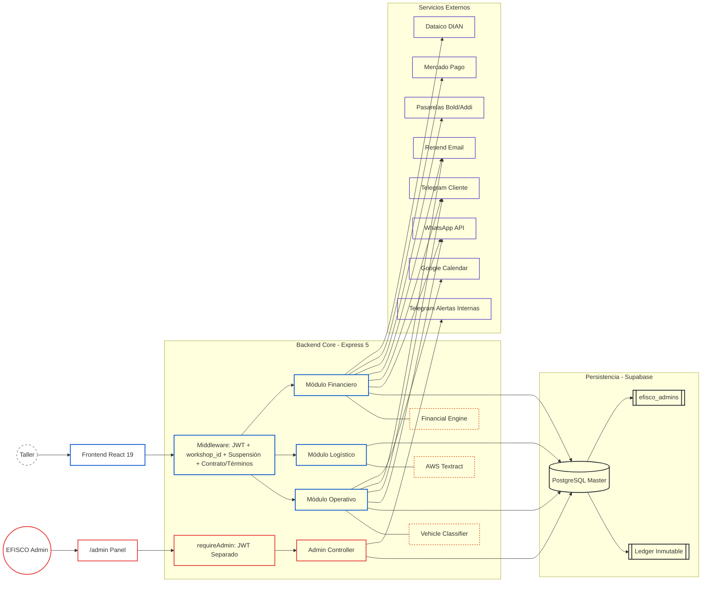
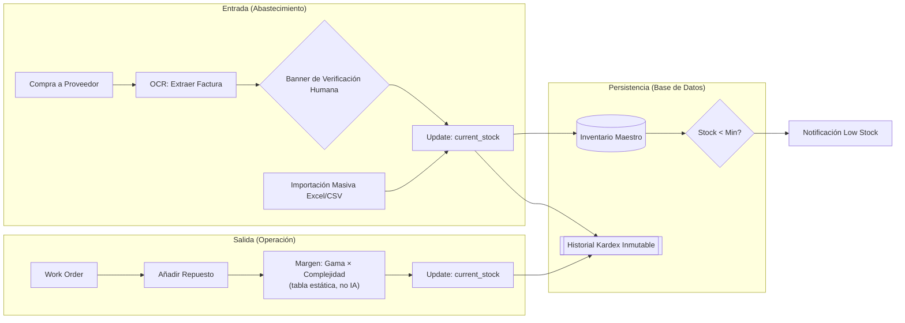

# Arquitectura del Sistema

> Ver también: [README](../README.md) · SECURITY-MODEL · SECURITY-HARDENING-HISTORY · API-REFERENCE · ENVIRONMENT-AND-DEPLOYMENT · [TESTING-AND-MONITORING](../ingenieria/testing-and-monitoring.md) · [RECEPTION-AND-QUOTES](../negocio/reception-and-quotes.md) · [WORK-ORDERS-AND-BAYS](../negocio/work-orders-and-bays.md) · [INVENTORY-AND-PROVIDERS](../negocio/inventory-and-providers.md) · [WORKSHOP-CONFIG-AND-PRICING](../negocio/workshop-config-and-pricing.md) · [FINANCIAL-ENGINE-SETTLEMENT](../finanzas/financial-engine-settlement.md) · [LEDGER-AND-ACCOUNTING](../finanzas/ledger-and-accounting.md) · [WORKSHOP-FINANCE-DASHBOARDS](../finanzas/workshop-finance-dashboards.md) · [GROWTH-AND-SUBSCRIPTION-BILLING](../comercial/growth-and-subscription-billing.md)

---

<!-- INDICE -->
**Índice** (leer solo lo necesario: `Grep "<texto>"` para ubicar la línea y leer con `offset`/`limit`):

- 1. Mapa de Componentes y Capas
- 2. Ciclo de Vida Operativo (End-to-End)
- 3. Stack Tecnológico
    - Chromium se cierra por inactividad (2026-09-27, incidente real en Render)
- 4. Decisiones Técnicas Clave
    - Ledger Inmutable
    - Pipeline OCR asíncrono
    - Tarificación dinámica por tier
    - Margen what-if fiel
    - Gotcha real de html2canvas/html2pdf.js (PDF en blanco)
    - Mobile-first auditado, no solo "responsive por Tailwind"
    - En este repo no existía convención de migraciones de esquema
    - Un contenedor Docker local puede acaparar un puerto y servir código viejo sin avisar
    - Una integración con el calendario personal de alguien no puede tener una cuenta "maestra"
    - Estado que se puede calcular en el momento no debería guardarse y sincronizarse a mano
    - Gotcha real de @mdi/react (CJS puro) bajo Vite
    - frontend/public/sitemap.xml/robots.txt para indexación en Google (2026-08-03)
    - Barrido de bugs de responsive mobile (2026-08-03)
- 5. Inventario y Kardex Inmutable
- 6. Rendimiento (auditoría 2026-09-19)
    - auth.middleware.js
    - Índices
    - Dashboard
    - Bundle inicial
    - Ruta crítica de carga
    - Peticiones duplicadas
    - Sensación de velocidad
- Rutas del frontend
- Paleta de comandos (Cmd/Ctrl+K)
<!-- /INDICE -->

## 1. Mapa de Componentes y Capas

*Nota: WhatsApp, Telegram y Resend Email forman una cascada de fallback (WhatsApp → Telegram → Email), no tres canales independientes — ver [OPERATIONS.md](../negocio/reception-and-quotes.md) para el orden real. Telegram Alertas Internas es un bot separado del bot de cliente (uso interno de monitoreo, ver [MONITORING.md](../ingenieria/testing-and-monitoring.md)).*

---

## 2. Ciclo de Vida Operativo (End-to-End)

> El canal `MSG` es una cascada de fallback — WhatsApp primero, Telegram si falla, Email (Resend) si ambos fallan — no un canal único (ver [OPERATIONS.md](../negocio/reception-and-quotes.md)). Excepción (2026-10-10): los comprobantes PDF de venta y de pago de cuota van además SIEMPRE por correo (`alwaysEmail` en `messagingChannelService.sendDocument`), no solo como último respaldo. Desde el 09-ago-2026 el QR de "Registro Seguro EFISCO" es el camino principal en Recepción, no WhatsApp (que además está deshabilitado en producción, ver el interruptor del canal de WhatsApp abajo).

```mermaid
sequenceDiagram
    autonumber
    participant C as Cliente
    participant R as Recepción
    participant B as Bahía (Ops)
    participant I as Inventario
    participant F as Finanzas
    participant MSG as Cascada (WhatsApp→Telegram→Email)
    participant EXT as Externos (DIAN/Pay)
    participant DB as Persistencia (DB)

    C->>R: Ingreso (Reporte de Fallo)
    activate R
    R->>C: QR de Registro Seguro EFISCO
    R->>B: Convertir a Orden de Trabajo
    activate B
    Note over B: El Classifier asigna Tier (Básico/Premium)
    deactivate R

    loop Durante el Servicio
        B->>I: Solicitar Repuesto
        activate I
        I->>DB: Validar Stock & TX
        DB-->>I: Confirmación
        I-->>B: Item Entregado
        deactivate I
        B->>B: Acumular Costos
    end

    B->>MSG: Aviso de Valor Tentativo
    MSG->>C: Notificación (precio estimado)

    B->>F: Finalizar y Liquidar
    activate F
    deactivate B

    rect rgb(0, 0, 0)
        Note over F, DB: Proceso de Cierre Contable (Fiscal 2026)
        F->>F: Calcular FinancialEngine
        F->>DB: Marcar Orden Completada
        F->>DB: Insertar Movimientos Ledger (atómico)
        F->>EXT: Emitir Factura & Procesar Pago
    end

    F->>MSG: Vehículo Listo + Factura Digital
    MSG->>C: Notificación (WhatsApp → Telegram → Email)
    deactivate F
```

---

## 3. Stack Tecnológico

| Capa | Tecnología | Rol |
|:---|:---|:---|
| UI | React 19 + Vite | SPA con routing client-side |
| Estilos | Tailwind CSS v4 | Design system utilitario |
| Estado | Zustand | `useAuthStore`, `useFinancialStore`, `useBillingStore`, `useThemeStore`, `useAdminStore`, `useInstallStore`, `useSetupStore`, `useLockStore`, `useProvidersStore`, `useCookieConsentStore`, `useInstallmentsStore`, `useCashFlowStore` |
| Backend | Express 5 + Node.js ESM | API REST con async/await nativo |
| Base de datos | Supabase (PostgreSQL) | Persistencia + aislamiento multi-tenant a nivel de aplicación |
| OCR | AWS Textract | Extracción de facturas de proveedores |
| Comunicaciones | Meta WhatsApp Cloud API + Telegram Bot API + Resend | Cascada de notificaciones/documentos (WhatsApp → Telegram → Email) — WhatsApp está el interruptor del canal de WhatsApp en producción desde 2026-08-18 (cuenta de Meta desactivada), así que hoy la cascada opera en la práctica como Telegram → Email; ver ARCHITECTURE.md — Variables de Entorno y `messagingChannel.service.js` |
| PDF server-side | Puppeteer + Chromium headless | Motor genérico HTML→PDF (`pdfRenderer.service.js`) reusado por las tres plantillas del sistema — reporte de puntaje, comprobante de pago (por cuota) y comprobante de venta (al liquidar) — así el backend es la única fuente tanto para la autodescarga del cliente como para el envío por WhatsApp: exactamente el mismo documento en los dos lugares, en vez de dos implementaciones distintas |
| Facturación | Dataico | Emisión DIAN electrónica (no bloqueante) |
| Excel server-side | `exceljs` | Genera el Libro Mayor único (`.xlsx` real) que descarga el contador — reemplaza los 6 reportes CSV anteriores |
| Calendario | Google Calendar API (`googleapis`) | Sincroniza órdenes de trabajo con el Google Calendar personal de cada persona (dueño + mecánicos), cada quien con su propia conexión OAuth — ver [OPERATIONS.md](../negocio/work-orders-and-bays.md#sincronización-con-google-calendar) y(modelo de seguridad interno) |
| Pasarelas | Bold (físico/online/QR) + Addi (crédito) | Procesamiento de pagos |
| Crypto | Node.js `crypto.scrypt` | Hash de contraseñas admin (sin bcrypt) |
| PWA | `manifest.json` + `public/sw.js` + íconos maskable/any | Instalable como app desde el celular, con ícono correcto (margen de seguridad para el recorte automático del sistema). `sw.js` es un service worker mínimo sin caché — su único propósito es cumplir el requisito de instalabilidad de Chrome/Edge/Android para que el navegador dispare `beforeinstallprompt` (botón "Instalar" real en Landing/Auth, capturado en `useInstallStore`). `start_url: "/login"` (con `scope: "/"` explícito) — abrir el ícono instalado sin sesión activa lleva directo al login, no a la Landing de presentación |

- **Chromium se cierra por inactividad (2026-09-27, incidente real en Render)** — antes `pdfRenderer.service.js` dejaba un solo Chromium abierto para siempre. En la instancia de 512MB, Node solo ocupa ~120MB, pero con Chromium abierto la memoria quedaba en ~330-400MB. Esa noche, tres abonos seguidos (comprobante de pago) y una liquidación a crédito con fotos (comprobante de venta) pasaron el límite y Render reinició la instancia ("exceeded its memory limit"). Ahora: se cierra tras `PDF_BROWSER_IDLE_MS` sin generar PDFs (2 min por defecto), nunca con una pestaña en curso (contador `activePages`), se olvida la instancia si Chromium muere solo (`disconnected`) o si el arranque falla (antes quedaba cacheada una promesa rechazada), y se lanza con flags que bajan RAM (`--disable-gpu`, `--disable-extensions`...). Para que el arranque en frío no se sienta: `POST /api/billing/pdf-warmup` al abrir las pantallas que van a generar un PDF, y `components/ui/PdfPreparingOverlay.jsx` (hoja animada + pasos) mientras se espera, en liquidación, descarga del comprobante, abono de cuota, reimpresión en Historial y reporte de puntaje público. **Fila de espera**: como Chromium es uno solo para todos los talleres, el riesgo al crecer no es el número de talleres sino varios PDFs a la vez (cada pestaña ~20-60MB, más con fotos). Máximo `PDF_MAX_CONCURRENCY` renders simultáneos (1 por defecto, para 512MB); el resto espera en orden de llegada (medido en local: ~120ms por PDF, el 3.º de 3 simultáneos sale a los ~365ms; en Render con 0.5 CPU calcular varias veces más). Subir el valor solo junto con un plan de más RAM. Tests: `backend/tests/pdfRenderer.idleClose.test.js`.

---

## 4. Decisiones Técnicas Clave

- **Ledger Inmutable** — Cada movimiento financiero es append-only. Trazabilidad contable completa y auditable. Ver [FINANCIAL_ENGINE.md](../finanzas/ledger-and-accounting.md#libro-auxiliar-cash-flow-ledger).
- **Pipeline OCR asíncrono** — Procesamiento de facturas en segundo plano vía AWS Textract.
- **Tarificación dinámica por tier** — Clasificador de vehículos asigna el tier automáticamente (Básico/Premium).
- **Margen what-if fiel** — El cálculo de proyección del [Panel de Equilibrio](../finanzas/workshop-finance-dashboards.md#panel-de-equilibrio-equilibrio) usa costo variable absoluto por orden (`varCostPerOrder`), no margen porcentual fijo. Al subir precios, el margen % mejora automáticamente porque los costos de partes no suben.
- **Gotcha real de `html2canvas`/`html2pdf.js` (PDF en blanco)** — posicionar el contenedor a capturar con coordenadas muy negativas (`position:fixed;top:-9999px`) es una causa documentada de canvas vacío en algunos navegadores. El patrón correcto en este proyecto (`generateScorePDF.js`): `position:absolute` dentro del flujo normal del documento + `opacity:0;pointer-events:none`, más un frame de espera (`requestAnimationFrame` doble) antes de capturar, para darle tiempo al navegador de terminar el layout/paint del contenido recién inyectado.
- **Gotcha real de `html2canvas` + Tailwind v4 (botón "Descargar Comprobante PDF" que nunca terminaba, 2026-08-27, reportado por el usuario)** — Tailwind v4 resuelve su paleta por defecto en `oklch()` (confirmado con `getComputedStyle` sobre cualquier clase `text-slate-*`/`border-slate-*` real de la app), y `html2canvas` (la librería que usa `html2pdf.js` internamente, sin actualizar desde antes de que existieran los espacios de color modernos en CSS) no sabe parsear `oklch()`/`lab()`/`color()` — lanza `Error: Attempting to parse an unsupported color function "oklch"` dentro de su paso interno de `parseTree`, después de clonar el documento (por eso el botón se sentía "colgado": el clon + el escaneo de todas las reglas CSS antes de llegar al error ya tardaba 1-2s). Cualquier `html2canvas`/`html2pdf.js` nuevo en este proyecto (Tailwind v4 en todo el frontend) va a pisar el mismo error. **Detalle no obvio**: `html2canvas` llama `parseTree` sobre el **documento clonado completo**, no solo el elemento que se va a capturar — confirmado en la app real (372 elementos en la página de Recepción, 284 con algún color resuelto en oklch) — así que el fix tiene que aplicarse a TODO `document.querySelectorAll('*')`, no solo al subárbol del elemento objetivo (un primer intento acotado a ancestros+descendientes del elemento no bastó). Solución sin dependencias nuevas (`ModalLiquidacion.jsx:flattenColorsForCapture`, hook `onclone` de `html2canvas`): cualquier color computado (`getComputedStyle`) se normaliza a `rgb()`/`rgba()` pintándolo en un canvas de 1×1 y leyendo el pixel con `getImageData` — el canvas 2D siempre devuelve componentes sRGB numéricos sin importar en qué espacio de color se haya escrito el string original — y se sobreescribe como estilo inline en cada nodo del clon antes de que `html2canvas` intente parsearlo. Alternativa descartada por mayor alcance de cambio: reemplazar `html2canvas` por el fork mantenido `html2canvas-pro` (sí soporta oklch nativamente), que habría exigido dejar de usar `html2pdf.js` como wrapper y reimplementar su paginación a mano. **Abandonado por completo poco después (2026-08-27, mismo día)**: en vez de seguir manteniendo el parche de `flattenColorsForCapture`, el botón "Descargar Comprobante PDF" de `ModalLiquidacion.jsx` se reescribió para pedirle al backend el mismo PDF que ya genera Puppeteer para la cascada de WhatsApp/Telegram/Email (`POST /api/billing/receipt-pdf`, nuevo endpoint que llama a `renderSaleReceiptBuffer`) — un solo documento real en vez de dos implementaciones (una en el navegador con `html2canvas`, otra en el servidor con Puppeteer) que ya habían divergido visualmente. `html2pdf.js`/`html2canvas` dejaron de usarse para este documento específico; el patrón sigue documentado arriba porque cualquier otro botón de descarga nuevo que capture DOM en el navegador (en vez de pedirle un PDF ya armado al backend) va a pisar el mismo error de `oklch()`.
- **Mobile-first auditado, no solo "responsive por Tailwind"** — tener clases `md:`/`sm:` no garantiza que algo se vea bien en un celular real; varios contenedores con `flex ... items-center` (sin `w-full`) se centraban en vez de estirarse en mobile, causando overflow simétrico en ambos lados (ej. filtros de Bahía, footer). El patrón correcto en este proyecto: contenedores con `w-full sm:w-auto` + filas de tabs/filtros con `overflow-x-auto` explícito (nunca asumir que el contenido cabe). Modales largos siempre con `max-h-[90vh] flex flex-col` + región central `overflow-y-auto flex-1` (header/footer fijos) — sin esto, contenido más alto que la pantalla queda inaccesible en el celular, sin forma de hacer scroll. **`ModalLiquidacion.jsx` roto a 320px de ancho (2026-09-03, reportado por el usuario, verificado con Claude en Chrome resimulando la orden real a 320px)**: header/contenido/footer usaban padding fijo de escritorio (`p-8`/`p-6`) sin ningún override móvil, y varias filas `flex justify-between` (sin `flex-wrap`) — a 320px el botón de cerrar (X) del header quedaba empujado fuera del área visible, dejando el modal sin forma de cerrarse. Corregido con `p-4 sm:p-8`/`p-4 sm:p-6` en cada contenedor, `flex-wrap`/`min-w-0`/`truncate` en las filas título+botón y etiqueta+valor, e íconos/texto más chicos en el breakpoint base. Mismo patrón a auditar en cualquier modal nuevo: un padding fijo que "se ve bien" en desarrollo (pantalla ancha) no garantiza nada a 320px real.
- **`position:absolute` no escapa el `overflow:hidden` de un ancestro lejano si un ancestro MÁS CERCANO ya es positioned o tiene `transform`** (`Proveedores.jsx`, 2026-09-03, reportado por el usuario: "al imprimir un comprobante o un reporte PDF sale en blanco"): el patrón de impresión (`.printable-report`/`.printable-voucher`, ocultos por default y mostrados con `body.printing-* { visibility }` + `position:absolute;top:0;left:0` bajo `@media print`, pensado para anclarse a la página completa) vivía dentro de `<main class="... relative overflow-y-auto ...">` (`App.jsx`) y del `motion.div` de `PageTransition.jsx` (Framer Motion deja un `transform` inline permanente incluso en reposo). La resolución de containing block para `position:absolute` sube por el árbol y se detiene en el ANCESTRO MÁS CERCANO que sea `position!=static` o tenga `transform`/`filter`/`perspective`/`will-change`/`contain` — acá era el `motion.div`, no la página como se asumía — así que el elemento nunca escapaba de la cadena de `overflow`/`height:0` que el propio CSS de impresión colapsa a propósito para ocultar el resto de la interfaz, y la impresión/PDF salía en blanco. Corregido sacando ambos bloques del árbol de la página con `createPortal(..., document.body)` — como hijos directos de `<body>`, ningún ancestro intermedio puede volver a interceptar su `position:absolute`. Antes de asumir que un `position:absolute`/`fixed` "se ancla a la página", verificar que NINGÚN ancestro entre el elemento y `body` tenga `position`, `transform`, `filter`, `perspective`, `will-change` o `contain` — un wrapper de animación (Framer Motion, page transitions) es candidato frecuente y fácil de pasar por alto porque no se ve en el JSX del propio componente.
- **Un evento del navegador que solo se dispara una vez debe vivir en un store global, no en un hook local de página** — `beforeinstallprompt` (botón "Instalar" de Landing/Auth) se capturó primero en un hook dentro de cada página; el navegador lo dispara una única vez, así que al navegar de `/` a `/login` (React Router desmonta una página y monta la otra) el hook nuevo arrancaba en `null` y el evento ya capturado se perdía — el botón "desaparecía" al cambiar de pantalla. Corregido moviendo la captura a `useInstallStore` (Zustand), inicializado una sola vez en `App.jsx`: cualquier evento de navegador que sea "úsalo o piérdelo" (single-fire) necesita vivir por encima del ciclo de vida de las páginas que lo consumen.
- **Un preview/simulador en el frontend debe reusar las mismas fórmulas del motor real del backend, no reimplementarlas con sus propias constantes** — tanto `ModalLiquidacion.jsx` (preview de liquidación) como `useFinancialStore.calculateLiveInvoice` (simulador, sin caller activo hoy) traían su propia copia de la lógica de IVA/retenciones con tasas fijas (19%, 4%, 0.966%) y sin el umbral UVT ni el gate por régimen del taller que sí aplica `financialEngine.liquidateClientInvoice` — dos implementaciones del mismo cálculo que fueron divergiendo con el tiempo a medida que el backend se volvía configurable (rev. 25, bug #11), hasta que el cajero podía ver un "Total Neto" en pantalla distinto del que de verdad se liquidaba. Corregido replicando exactamente los mismos parámetros y comparaciones que el backend (incluida la lectura explícita contra `null`/`undefined` en vez de `|| default`, ver [FINANCIAL_ENGINE.md](../finanzas/financial-engine-settlement.md)) — cualquier preview de un cálculo que también existe en el backend debe leer su configuración real (`workshop_config`) y replicar la fórmula tal cual, nunca hardcodear valores "razonables" por separado. **La misma categoría de bug reapareció en rev. 40**, más angosta: el preview ya replicaba la fórmula completa de retenciones/IVA, pero le faltaba una sola línea del backend — el IVA (19%) que el motor cobra sobre la comisión de la pasarela misma (`commissionVat`) antes de restarla del neto. Un "replicar la fórmula" no es una tarea de una sola vez: cada línea nueva que se agregue al motor real (aquí, la retención de la pasarela sobre el giro de rev. 38) es candidata a quedar fuera del preview si no se audita explícitamente contra el código del backend línea por línea al momento de tocarlo.
- **Un "saldo"/"pasivo" que se muestra en dos pantallas distintas necesita el mismo alcance de fechas, no solo la misma fórmula** — `getDashboardSummary` (Dashboard Financiero) calcula `financialEngine.calculateGlobalHealth` sobre TODO el histórico del ledger, sin filtro de fecha; `getCashFlow` (Flujo de Caja) reimplementaba la misma idea a mano, pero solo con los asientos dentro del rango `[from,to]` elegido (por defecto, el mes en curso), sin encadenar el saldo/IVA acumulados de meses anteriores. Para cualquier taller con más de un mes de uso, "Saldo Real"/"IVA Pendiente DIAN" de las dos pantallas divergían — no por una fórmula distinta, sino porque una veía todo el histórico y la otra solo una ventana. Corregido haciendo que `getCashFlow` calcule también, con `calculateGlobalHealth`, el saldo/IVA reales de antes de `from` y la posición acumulada real hasta `to` (ver [FINANCIAL_ENGINE.md](../finanzas/ledger-and-accounting.md#3-salud-financiera-global-calculateglobalhealth)) — una métrica de "posición" (saldo, pasivo) siempre debe ser acumulada hasta una fecha de corte; solo las métricas de "flujo" (ingresos, egresos de ESTE período) deben acotarse al rango elegido.
- **Un "ingreso" en el panel de EFISCO debe verificar de QUIÉN es esa plata, no solo sumar el ledger que esté más a mano** — `getStats` (Panel Admin EFISCO) sumaba `cash_flow_ledger`/`INC_GROSS`, que es la venta bruta de CADA TALLER a sus propios clientes, y lo mostraba como "Ingresos plataforma"/"Ingresos procesados" de EFISCO — un número sin relación con lo que los talleres realmente le pagan a EFISCO (podía superar los $40M con solo un puñado de talleres activos, frente al ingreso real de EFISCO, órdenes de magnitud menor). El ledger correcto para el ingreso de EFISCO es `efisco_accounting_ledger` (`direction='income'`) — un ledger completamente aparte, sin `workshop_id`, que ya usaba correctamente la pestaña Contabilidad del mismo panel. En un sistema con dos "libros" distintos (el de cada taller y el propio de EFISCO), cualquier KPI nuevo debe declarar explícitamente de cuál libro sale, y el texto de la UI debe decirlo tal cual — el propio subtítulo ("facturado por todos los talleres") ya delataba el bug antes de que alguien mirara el código.
- **Un default hardcodeado que en realidad es un umbral legal debe declarar su fecha de vigencia y su riesgo de cambiar** — los topes UVT de retención (`retention_threshold_parts_uvt`, `retention_threshold_services_uvt`) parecían una constante estable ("27 UVT, así ha sido siempre"), pero el Decreto 572/2025 los bajó, el Consejo de Estado los suspendió y luego revivió el decreto en cuestión de semanas (mayo-julio 2026) — ambos valores cambiaron 3 veces en menos de 60 días por una demanda de nulidad todavía en curso. Corregido actualizando los defaults a los vigentes hoy (10/2 UVT) y agregando una alerta permanente en el panel del contador (no solo un comentario en el código) recordando verificar la norma vigente — un valor que la ley puede cambiar por fuera del control del software necesita ser fácil de corregir Y visible que puede estar desactualizado, no solo "configurable en algún input".

- **Un mensaje de error que se muestra al usuario nunca debe ser el `.message` crudo de la base de datos** — casi todos los controllers (109 sitios en 12 archivos) hacían `res.status(500).json({ error: error.message })` sin distinguir un `Error` de aplicación (ya en español, ej. "Repuesto no encontrado") de un error real de Postgres/PostgREST (constraints, nombres de columna, "duplicate key value violates unique constraint..."), que terminaba mostrado tal cual al cajero/dueño. Corregido con `backend/utils/dbErrors.js:friendlyDbError` — distingue por `error.code` (SQLSTATE, solo presente en errores reales de base de datos): con `code`, mapea a un mensaje en español; sin `code`, devuelve `error.message` intacto (mismo comportamiento de siempre para los `throw new Error(...)` de aplicación). El detalle técnico real sigue disponible para quien loguee `error` server-side — la función solo decide qué cruza la frontera hacia el cliente. Patrón a replicar: cualquier controller nuevo debe usar `friendlyDbError(error)` en su catch de 500, nunca `error.message` a secas.
- **El otro lado del mismo bug: el frontend puede descartar un mensaje de error ya sanado que el backend sí mandó** (2026-09-03, reportado por el usuario tras un caso real: una placa de moto en formato inválido dio como resultado un genérico "Hubo un problema al enviar sus datos. Intente nuevamente." en `ClienteRegistro.jsx`, sin decir por qué). El backend ya hace bien su parte (ver bullet de arriba — `friendlyDbError`/mensajes de aplicación en español), pero varios `if (!response.ok) throw new Error('texto fijo')` en el frontend nunca leían el `error` del body de la respuesta, tirando esa información a la basura y mostrando siempre el mismo texto genérico sin importar la causa real (red caída, validación de placa, correo faltante, etc.) — encontrados y corregidos 6 sitios (`ClienteRegistro.jsx` ×2, `ModalLiquidacion.jsx`, `ContadorInventario.jsx` ×3, `useFinancialStore.js`). El resto del frontend ya hacía bien esto (`data.error || 'mensaje de respaldo'`) — no era un problema sistémico, solo unos pocos sitios sueltos que no seguían el patrón ya establecido en el resto de la app. Patrón a replicar: `if (!res.ok) { const d = await res.json().catch(() => null); throw new Error(d?.error || 'mensaje de respaldo'); }` — **excepto** en flujos de autenticación (login, PIN, token de soporte), donde un mensaje genérico deliberado es lo correcto para no filtrar si un correo/token existe (`Auth.jsx` ya lo hacía bien desde antes, no tocar ese caso).
- **Un debounce o una petición dependiente de un id cambiante necesita un `useEffect` con cleanup real, no un `setTimeout`/fetch suelto dentro de un event handler** — 2 instancias del mismo bug encontradas en rev. 42: `AdminWorkshops.jsx:handleSearch` armaba su debounce (`setTimeout` + `return () => clearTimeout(t)`) dentro de un `onChange` — ese `return` no lo ejecuta nadie fuera de un `useEffect`, así que cada tecla disparaba un fetch nuevo sin cancelar los anteriores (fetch por letra + una respuesta vieja podía pisar resultados nuevos); y `Config.jsx` cargaba historial/métricas/pago-pendiente de un empleado en un `useEffect` keyed por su id, pero sin ningún guard contra la respuesta de un empleado anterior llegando tarde — abrir el panel de A y luego rápido el de B podía dejar el panel de B con datos de A. Ambos corregidos con las 2 técnicas estándar de React para "una respuesta async puede llegar después de que ya no aplica": debounce real dentro de un `useEffect(() => { const t = setTimeout(...); return () => clearTimeout(t); }, [dep])`, y un flag `cancelled` (seteado en el cleanup, chequeado antes de cada `setState` en el `.then()`) para peticiones en vuelo que dependen de un id que puede cambiar antes de que resuelvan.
- **Todo botón destructivo necesita bloqueo en vuelo, no solo confirmación** (2026-10-02, extiende el punto de abajo) — la misma clase de bug (doble clic manda varios `DELETE` y apila toasts, con errores 404 para los clics sobrantes) seguía en `Bahia.jsx` (eliminar orden, cliente en espera y repuesto de la orden: modales propios sin `ElegantConfirmModal`), `AdminAlerts.jsx` (quitar suscriptor de Telegram) y `VehiclePhotoUpload.jsx` (borrar foto). Patrón: estado `deleting`/id en curso, el handler sale si ya hay uno, el botón pasa a spinner "Eliminando..." y se deshabilita (y el Cancelar también, para no cerrar el modal a mitad). Dos errores silenciosos relacionados: `useProvidersStore.deleteProvider` no revisaba `response.ok` (el proveedor desaparecía de la lista y salía "eliminado correctamente" aunque el servidor lo rechazara) y `Config.jsx:handleDeleteService` no avisaba si el servidor respondía con error.
- **Un componente de confirmación compartido necesita su propio `loading`, no depender de que cada caller cierre el modal a tiempo** — `ElegantConfirmModal.jsx` (7 usos en el proyecto) no tenía ningún prop de estado de carga; varios callers (`AdminWorkshops.jsx`, `Proveedores.jsx`, `Recepcion.jsx`) solo cerraban el modal en el `finally` de su petición, así que el botón de confirmar seguía clickeable mientras la petición estaba en curso — doble clic podía disparar dos DELETE seguidos. Otros callers (`Inventario.jsx`, `ModalLiquidacion.jsx`) sí cerraban el modal de forma síncrona antes de la petición y nunca tuvieron el bug — la inconsistencia entre callers del mismo componente era la señal de que la protección debía vivir en el componente, no repetirse (con suerte) en cada uso. Corregido agregando `loading` (opcional, backward-compatible) a `ElegantConfirmModal`: deshabilita ambos botones y el cierre por backdrop/X, muestra spinner + "Procesando...". `Config.jsx` comparte un solo modal genérico entre 3 acciones distintas — en vez de tocar los 3 handlers, se envolvió el `onConfirm` una sola vez en el punto donde se conecta al modal (`handleConfirmModalClick`), beneficiando a los 3 sin duplicar lógica.
- **Una escritura que depende de otra debe ordenarse por cuál es más barata de reintentar, no por el orden "natural" en que se piensan** — `settleOrder` insertaba el ledger financiero y RECIÉN DESPUÉS marcaba la orden como `completed`. Si ese segundo update fallaba (conexión caída, timeout), la orden quedaba sin `completed` y un reintento del usuario (mismo botón, mismo click) volvía a pasar la única guarda de idempotencia (que solo mira el `status` al principio de la función) y duplicaba TODOS los asientos financieros — ingreso, IVA, retenciones, comisiones, todo doblado. Corregido invirtiendo el orden: primero se marca la orden como `completed`, y el ledger se inserta después. Si el insert del ledger llegara a fallar en ese punto, el resultado es una orden completada sin su ledger (un hueco visible y auditable con una consulta simple), no dinero duplicado en el libro contable — entre dos escrituras dependientes que no pueden ser una sola transacción real, la más segura de reintentar debe ir de última.
- **El admin API de Supabase (`auth.admin.listUsers`) pagina — cualquier búsqueda por email debe agotar todas las páginas, no confiar en `perPage` alto** — `requestPasswordReset` y `getWorkshops` llamaban `listUsers({ perPage: 1000 })` una sola vez, así que el usuario 1001+ (por antigüedad de creación, no por orden alfabético) quedaba invisible: sin correo de recuperación, sin `owner_email` resuelto en el panel admin. Corregido con `backend/utils/authUsers.js` (`listAllAuthUsers`), que pagina hasta que una página devuelve menos de `perPage` resultados — cualquier consumidor nuevo que necesite buscar o mapear por email debe reusar este helper en vez de una llamada suelta.
- **Una regla de negocio corregida en un solo lugar tiende a reaparecer en cualquier otro lugar que la reimplemente por su cuenta — un fix necesita un utilitario compartido, no una corrección puntual** — el bug de "hoy en Colombia ≠ hoy en UTC" (Colombia es UTC-5 fijo, sin horario de verano; cualquier acción entre las 7pm y medianoche hora local ya tiene un `created_at` UTC del día/mes siguiente) ya se había corregido dos veces por separado, cada vez a mano: en `getMonthlyBooks` (rev. 25/Bug #14, cierre de libros mensuales) y en `Cobros.jsx` ("Vencida"). Ninguna de las dos correcciones se extrajo a un helper reusable, así que en rev. 47 el mismo bug apareció intacto en otros 17 sitios que también calculaban "hoy"/"mes en curso" con `new Date().toISOString().split('T')[0]`/`.substring(0,7)` cada uno por su cuenta — Flujo de Caja (el reporte que lo hizo evidente), el badge de cuotas vencidas del Dashboard/Sidebar (que ya tenía el fix correcto al lado, en `Cobros.jsx`, sin que nadie lo reusara), el score de riesgo de clientes, comisiones de mecánicos, KPIs del panel admin, kardex de inventario, y las fechas por defecto de varios formularios. Corregido de raíz con `frontend/src/utils/localDate.js` / `backend/utils/localDate.js` (espejo, mismo patrón que `ledgerLabels.js`/`financialEngine.js`) — cualquier cálculo nuevo de "hoy" o "mes en curso" en este proyecto debe importar de ahí, nunca instanciar su propio `new Date().toISOString()`. Un hallazgo más profundo de la misma revisión: el filtro de rango de `getCashFlow`/`getCompletedOrders` recibía `from`/`to` del frontend como timestamps SIN offset de zona horaria, y Postgres los interpretaba con el timezone de la sesión (UTC) — un bug de un nivel más abajo que el de "cómo se muestra la fecha", este sí capaz de traer datos incorrectos de la base, no solo mostrarlos mal (helper `asBogotaIso`).

**Misma familia de bug, variante distinta, reapareció en 2026-07-29**: no es el cálculo de "hoy"/rango de arriba, sino `toLocaleString`/`toLocaleDateString`/`toLocaleTimeString` llamados en el **backend** sin `timeZone` explícito — el locale `'es-CO'` solo controla el idioma del formato (nombres de mes, separadores), NO la zona horaria; sin `timeZone`, JavaScript usa la del proceso de Node, que en producción corre en la nube (normalmente UTC), no en Bogotá. Encontrado en 4 sitios que generan documentos reales para el usuario final: la columna "Fecha" del Libro Mayor (`finance.controller.js:generateLedgerBook`), el Comprobante de Pago y el Comprobante de Venta (`paymentReceiptTemplate.js`/`saleReceiptTemplate.js`, enviados por WhatsApp), y el reporte de Score (`scoreReportTemplate.js`) — cualquier evento entre las 7pm y medianoche hora Bogotá aparecía fechado al día siguiente en estos documentos. Corregido agregando `timeZone: 'America/Bogota'` explícito en cada llamada — **excepto** `saleReceiptTemplate.js`'s `due_date` (columna `date` pura, sin hora), que se ancla a `timeZone: 'UTC'` en vez de Bogotá: `new Date('YYYY-MM-DD')` ya parsea como medianoche UTC, así que convertir esa fecha a Bogotá (UTC-5) correría el día calendario al anterior — el fix correcto para un valor `date` puro es preservar el día tal cual, no reinterpretarlo como un instante real. A diferencia del bug de arriba (que sí tenía un helper centralizado, `localDate.js`, que nadie reusó), esta variante no tenía ningún caso previo corregido de qué copiar — no existía un wrapper compartido para "formatear un timestamptz en hora de Bogotá para mostrárselo al usuario", así que cada sitio necesitó el fix a mano; candidato a extraerse a un helper si aparece una quinta ocurrencia.

- **Primera función de Postgres (RPC) de este proyecto (2026-07-29) — el "sin RPC" de arriba dejó de ser una regla absoluta.** `documentNumbering.js` reclamaba el consecutivo del Libro Mayor con un patrón optimista de dos pasos hecho desde el cliente (`SELECT` + `UPDATE...WHERE`, con reintento) explícitamente para NO necesitar una función de base de datos — comentario que quedó obsoleto: ese patrón dejaba una ventana real de desorden entre dos transacciones HTTP independientes (ver [FINANCIAL_ENGINE.md — reclamo atómico](../finanzas/ledger-and-accounting.md#número-de-documento-2026-07-28)), y cerrarla de verdad exigía que el reclamo del consecutivo y el insert de las filas del comprobante ocurrieran en una sola transacción — algo que dos llamadas HTTP separadas de PostgREST no pueden garantizar sin una función que las una. Se agregó `scripts/migrations/2026-07-29_atomic_document_number_claim.sql` con dos funciones `plpgsql`, aplicadas a mano en el SQL Editor igual que cualquier otro cambio de esquema (mismo flujo de arriba, sin runner). Lección: evitar RPC es una buena heurística por defecto (menos piezas móviles, todo el cambio vive en JS versionado) hasta que la propia correctitud del dato depende de una garantía transaccional que el cliente no puede dar por sí solo — ahí el RPC no es una preferencia de estilo, es la única forma correcta.
- **Un contenedor Docker local puede acaparar un puerto y servir código viejo sin avisar** (rev. 49): además del `node server.js`/`nodemon` de siempre, existe `backend/docker-compose.yml` (contenedor `efisco-api`, imagen con el código *horneado* en el build — sin bind mount), que puede quedar corriendo horas después de haberlo levantado una vez. Si además hay un `node server.js` local sobre el mismo puerto 3000, ambos procesos aparecen en `netstat`/`docker ps`, y las peticiones pueden estar llegando al contenedor viejo — los síntomas son confusos porque el request SÍ llega a un Express real y responde 2xx coherente (mismo mensaje, misma forma de JSON), solo que con la lógica de antes del último cambio; en este caso, una columna nueva que el backend debía persistir llegaba `null` pese a que el payload del frontend y el código en disco eran correctos. Señal para reconocer el patrón: un cambio de backend que compila y pasa sus tests pero no se refleja al probar en vivo → verificar `docker ps` antes de sospechar del código.
- **Una función ya escrita puede quedar como código muerto esperando a que el resto del sistema la alcance** (rev. 49): `backend/utils/pricing.js:getServiceMargin` (con tests en `pricing.test.js` que documentan la tabla completa) existía desde antes de esta revisión, sin ningún caller en producción ni las columnas de BD (`service_catalog.gama`/`complejidad`) que necesitaba para ser útil — quedó ahí, probada pero inerte, hasta que una imagen de referencia del usuario (tabla de márgenes por Gama/Complejidad) resultó coincidir exactamente con esa función ya implementada. Antes de construir una feature nueva "desde cero" vale la pena buscar si ya hay una función con el nombre/forma correcta en `utils/` — puede que ya esté escrita y solo falte conectarla.

- **Un elemento persistente de UI (drawer/sidebar) no puede abrirse/cerrarse en función de "algún paso de la secuencia lo necesita" — tiene que ser "el paso ACTUAL lo necesita"** (`frontend/src/utils/tour.js`, rev. 50): la guía de usuario móvil (driver.js) chequeaba, al arrancar, si *algún* paso de la secuencia completa apuntaba al `<aside>` del menú — si sí, abría el drawer para TODA la duración del tour. El tour de Inicio termina señalando el menú principal, así que sus primeros 4 pasos (título, bahía, financiero, mes) se resaltaban con el drawer + su overlay ya tapando el contenido detrás. Corregido moviendo la apertura/cierre del drawer a hooks `onNextClick`/`onPrevClick` en el `popover` del paso vecino al de `aside` — se abre/cierra justo en la transición hacia/desde ese paso puntual (esperando el fin de la transición CSS de 500ms antes de dejar que driver.js mida la posición del elemento), no al inicio del tour completo.
- **Un paso de un tour guiado que apunta a un elemento condicional puede quedar "flotando" sin avisar** (rev. 50): dos pasos del tour de Equilibrio (`.equilibrio-grafico`, `.equilibrio-whatif`) solo existen en el DOM si `hasData` es verdadero (ver [FINANCE.md](../finanzas/workshop-finance-dashboards.md#panel-de-equilibrio-equilibrio)) — si el selector no existe, driver.js no lanza error: cae a un elemento dummy de 0×0 centrado en pantalla y muestra el popover ahí, sin nada resaltado, una experiencia confusa sin ninguna señal de qué salió mal. `tour.js` ahora filtra, antes de arrancar, cualquier paso cuyo `document.querySelector(step.element)` no devuelva nada (excepto `aside`, siempre presente aunque oculto) — un tour con pasos condicionales debe verificar existencia real en el DOM, no asumir que el elemento que existía cuando se escribió el tour sigue montado.
- **Una guarda contra respuesta-fuera-de-orden es barata de agregar preventivamente, incluso sin poder confirmar que el bug ya ocurrió** (`Config.jsx:fetchEmployees`/`fetchServices`, rev. 50): mismo patrón ya documentado arriba (rev. 42) para el panel de detalle de un empleado, aplicado ahora a las dos listas completas del catálogo (servicios, equipo) — un contador de petición (`useRef`, incrementado al disparar cada fetch) que descarta cualquier respuesta que no sea la de la última petición en vuelo. A diferencia del bug de rev. 42, acá **no se confirmó una reproducción real**: la sospecha inicial (la lista no se actualizaba tras crear un registro) resultó ser, al probarlo con calma paso a paso, una lectura apresurada de la UI antes de que el fetch en curso resolviera — no un bug de la app. La guarda se dejó de todos modos por ser el mismo patrón de bajo costo/alto valor que ya probó su utilidad en rev. 42, no como confirmación de un defecto encontrado.
- **Un pipeline de render externo (fuente de contenido de una página pública) no necesita vivir en el repo de la app ni depender de sus mismas herramientas** (`media/hf-project/`, rev. 50): los 5 videos de [Demo pública](../comercial/growth-and-subscription-billing.md#demo-pública-demo-rev-50) se generan con [HyperFrames](https://github.com/heygen-com/hyperframes) (HTML+GSAP → MP4 vía Chrome headless + `ffmpeg`), un proyecto Node independiente fuera de `frontend`/`backend`, con su propio `package.json` y dependencia de sistema (`ffmpeg` en el `PATH`, no en `node_modules`). El único acoplamiento con la app es unidireccional y manual: los `.mp4`/`-poster.jpg` renderizados se copian a mano a `frontend/public/videos/demo/` — no hay build step ni CI que los regenere automáticamente. Iterar sobre la calidad/diseño de los videos (tipografía, animación, `--crf`) no requiere tocar la cuenta de prueba ni recapturar pantallas: las capturas fuente ya están en disco (`media/hf-project/assets/`).
- **Un botón fullscreen sobre un `<video>` necesita un fallback propietario para iOS Safari, no solo la Fullscreen API estándar** (`Demo.jsx:handleFullscreen`, rev. 50): `video.requestFullscreen()` no existe en iOS Safari — ahí el único camino es `video.webkitEnterFullscreen()`, una API que solo funciona invocada directamente sobre el elemento `<video>` (no sobre un contenedor `
` envolvente, a diferencia del resto de navegadores). Los controles nativos (`controls={isFullscreen}`, con el estado sincronizado vía los eventos `fullscreenchange`/`webkitfullscreenchange`) solo se muestran mientras dura la pantalla completa, para que el preview en la página quede limpio el resto del tiempo.
- **Un `border-2 border-transparent` que solo se vuelve visible en `:focus` es, en la práctica, invisible en modo oscuro hasta que se interactúa** (rev. 51): 47 inputs/selects/textareas en 8 archivos (`Inventario.jsx`, `Config.jsx`, `Recepcion.jsx`, `Bahia.jsx`, `DashboardFinanciero.jsx`, `ContadorInventario.jsx`, `OpeningBalanceModal.jsx`, `ContadorPanel.jsx`) usaban el mismo patrón — borde transparente en reposo, coloreado (`focus:border-slate-900 dark:focus:border-white`, con 2 variantes puntuales en azul/esmeralda) solo al enfocar. En modo claro el `shadow-inner` y el contraste contra el fondo blanco disimulaban la ausencia de borde; en modo oscuro, con el input y la tarjeta contenedora en tonos oscuros similares, el campo quedaba sin ningún borde visible hasta tocarlo — reportado por el usuario ("en modo oscuro no se ve nada"). Corregido reemplazando `border-transparent` por `border-slate-200 dark:border-slate-700` (un borde neutro visible en ambos modos) en los 8 archivos, sin tocar los colores de `focus:` ya definidos por cada uno.
- **Un texto que rota entre variantes de distinto largo no puede reemplazar el elemento completo — necesita reservar el espacio de la variante más alta** (`Landing.jsx`, 2026-07-25): el titular del hero rota entre 3 frases (`HEADLINES`) cada 4.5s reemplazando el `<h1>` completo (`key={headlineIdx}` + fade). Como las 3 frases tienen distinto largo (una envuelve a 3 líneas en pantallas angostas, las otras a 2), el alto del `<h1>` cambiaba en cada rotación y empujaba el párrafo de abajo ("EFISCO es el sistema operativo...") — un salto molesto justo mientras el usuario lo estaba leyendo, reportado como "da toc". Corregido apilando las 3 variantes en la misma celda de CSS Grid (`grid` + `[grid-area:1/1]` en cada una) en vez de montar solo la activa: el navegador dimensiona el contenedor por el contenido más alto de TODAS las celdas superpuestas, así que el alto queda fijo sin importar cuál esté visible; el cruce entre variantes pasa a ser solo de opacidad (`animate={{opacity: i === headlineIdx ? 1 : 0}}`), nunca de montaje/desmontaje. Patrón reusable para cualquier rotador de texto/contenido de largo variable que no deba mover el layout de alrededor.

- **Una integración con el calendario personal de alguien no puede tener una cuenta "maestra"** (Google Calendar, 2026-07-27): OAuth de Google no permite que una app cree eventos en el calendario de una persona sin que esa persona misma haya dado su consentimiento — así que "sincronizar las órdenes del taller" no es una integración única del dueño, es N conexiones independientes (dueño + cada mecánico que el dueño habilite), cada una con su propio `refresh_token`. `googleCalendarService.syncWorkOrder` resuelve el empleado-dueño internamente en cada llamada (no depende de `req.user`, porque quien crea/edita la orden no siempre es el dueño) y sincroniza en paralelo a cada persona conectada y habilitada, ignorando en silencio (fire-and-forget, `.catch(() => {})`) a quien no lo esté — un mecánico sin conectar simplemente no recibe eventos, sin que eso bloquee ni degrade la creación de la orden. Ver el flujo funcional completo en [OPERATIONS.md](../negocio/work-orders-and-bays.md#sincronización-con-google-calendar) y el manejo de tokens en(modelo de seguridad interno).

- **Una convención de signo propia puede cuadrar puertas adentro y seguir estando mal — el criterio real es si sobrevive al cruzar hacia un sistema externo que sí aplica la regla estándar** (Saldo Inicial, 2026-07-28): `OPENING_BALANCE` se insertaba como una sola línea `CREDIT` a Bancos, y el resto del motor (`openingBalanceValue`, `calculateGlobalHealth`) leía ese mismo `CREDIT` como "aumenta" — internamente autoconsistente, los totales de Finanzas/Flujo de Caja cuadraban. Pero esa convención está al revés de la partida doble real (un Activo aumenta por DÉBITO), y sin contrapartida el asiento nunca estuvo balanceado — solo que nada dentro de EFISCO lo exigía. El bug se volvió visible por dos caminos distintos, ninguno de los dos "los totales están mal": (1) el contador lo detectó al pensar en cómo se vería importado a Siigo/Alegra (un sistema que sí aplica la regla estándar, donde ese `CREDIT`-solo se lee como una reducción), y (2) una función de UI ya escrita correctamente (`getMovementFormatting`, que si aplica la regla estándar de Activo) ya pintaba esa fila en rojo — la inconsistencia estaba señalizada dentro de la propia app antes de que nadie la notara en los totales agregados. Lección: cuando una parte del sistema (una función de negocio) ya aplica la regla contable real y otra (el insert que genera los datos) usa una convención propia "que da el mismo resultado", ambas van a divergir tarde o temprano — y el punto de divergencia rara vez es donde se originó el bug. Ver [FINANCIAL_ENGINE.md](../finanzas/ledger-and-accounting.md#saldo-inicial--partida-doble-2026-07-28).
- **Un número de comprobante no puede recalcularse en el momento de exportar — tiene que persistirse en el instante en que el evento ocurre** (Número de Documento, 2026-07-28): la primera versión de esta idea calculaba el consecutivo (`FV-`/`CP-`/etc.) al vuelo dentro de `generateLedgerBook`, agrupando filas por `work_order_id`/`related_purchase_id` en el momento de exportar. El problema: si el contador exporta solo febrero hoy y marzo-febrero el mes que viene, un evento de febrero podría numerarse distinto entre ambas exportaciones según qué otras filas entraron al cálculo — rompiendo la referencia que el contador ya usó para importar el mes anterior a Siigo/Alegra. Corregido asignando el número una sola vez, en el `INSERT` original (`backend/utils/documentNumbering.js`, contador atómico por taller con el mismo patrón optimista que `dataico.service.js:claimInvoiceNumber`), y solo leyéndolo tal cual al exportar. Cualquier identificador que un sistema externo vaya a usar como referencia estable debe nacer en el momento del evento, no derivarse de una consulta que puede devolver resultados distintos según cuándo y con qué filtro se corra. El formato de ese consecutivo se corrigió una segunda vez el 2026-07-29 (quitarle el `padStart(3,'0')` que lo dejaba en `ASI-001` en vez de `ASI-1`) — el consecutivo por prefijo en sí nunca estuvo mal, solo el padding.
- **Un dato que el contador pide para un reporte no debe editarse desde el panel del contador — debe capturarse donde vive la fuente real del dato** (Tercero completo del Libro Mayor, 2026-07-28/29): el primer intento de agregar Tipo de Documento/Contribuyente/Dirección/Ciudad/Correo/Teléfono para el Excel puso un modal de edición completo dentro de `ContadorProveedores.jsx` (`/contador` → Proveedores) — parecía el lugar obvio porque fue el contador quien pidió el reporte. Se revirtió el mismo día: el contador no es quien conoce la dirección o el correo real de un proveedor, es el **dueño** (que ya lo registra en `Proveedores.jsx`) o el **propio cliente** (que ya se auto-registra en `ClienteRegistro.jsx`). El dato terminó agregado a esos dos formularios existentes, no a uno nuevo del contador — la pregunta correcta ante "¿dónde va este campo?" no es "¿quién lo va a usar?" sino "¿quién es la única persona que puede saber si es correcto?". Ver [FINANCIAL_ENGINE.md](../finanzas/ledger-and-accounting.md#tercero-completo--tipo-de-documentocontribuyente-dirección-ciudad-correo-teléfono-2026-07-29).
- **Un bug de "falta el asiento contable" tiende a repetirse en cualquier endpoint hermano que haga lo mismo por otro camino, no solo en el que se reportó** (Inventario Inicial, 2026-07-28): se corrigió `addStandaloneInventory` (alta de un ítem nuevo) para que insertara su partida doble — pero `updateStock` ("Añadir Stock", sumarle unidades a un ítem que ya existe) hacía exactamente lo mismo por un endpoint distinto, con el mismo gap, y no se tocó en la primera pasada porque el reporte del usuario no lo mencionó explícitamente. Se encontró recién al investigar por qué un taller específico tenía inventario "que no se le puso" — grepeando `current_stock` en el controller completo, no solo el endpoint ya señalado. Antes de dar por cerrado un bug de "esta acción no genera su asiento/registro/notificación", vale la pena buscar TODOS los caminos que llegan al mismo efecto (aquí, cualquier lugar que toque `inventory_transactions` con `type='invoice'`), no solo el que el usuario usó para notarlo. Corregido extrayendo la lógica compartida a `postInventoryOpeningBalance` (helper único, usado por ambos endpoints) para que un tercer camino futuro no pueda olvidarlo de nuevo tan fácil.
- **Un script de corrección de datos de un solo uso necesita revisar si YA se aplicó antes de replantear, no solo antes de escribir** (2026-07-28): tanto `fix-opening-balance-double-entry.mjs` como `backfill-inventory-opening-balance.mjs` seguían el patrón ya establecido (dry-run por defecto, `--confirm` + confirmación escrita para aplicar) pero ninguno de los dos verificaba, en el propio `planWorkshop`, si la fila que estaban a punto de listar ya tenía su corrección puesta — solo miraban la condición de entrada (`type='OPENING_BALANCE'` / `inventory_transactions` sin `purchase_id`), no si ya existía la fila de salida. Correr cualquiera de los dos una segunda vez (dry-run repetido no importa, pero un `--confirm` repetido sí) habría insertado pares duplicados o, en el caso del Saldo Inicial, vuelto a invertir un `impact` que ya estaba corregido, dejándolo mal otra vez. Se encontró al volver a correr el dry-run de `backfill-inventory-opening-balance.mjs` para verificar un caso puntual y ver que seguía listando alzas que el usuario ya había confirmado antes. Corregido agregando el cruce contra `cash_flow_ledger` antes de planear cada fila en ambos scripts. Todo script de este proyecto que "corrige N filas basándose en una condición" necesita una segunda condición — "y todavía no se corrigió" — antes de considerarse seguro para correr más de una vez, que es exactamente el escenario real (dry-run, revisar, dry-run de nuevo, `--confirm`) que este flujo de trabajo ya usa por diseño.
- **Una tabla hija nueva necesita sus Foreign Keys reales desde el primer día, no solo las columnas `_id` sueltas** (tablero de Herramientas, 2026-08-01): `work_order_tools` se creó con `work_order_id`/`tool_id` como `uuid` planos (sin `REFERENCES`), a diferencia de sus tablas hermanas (`work_order_mechanics_order_fkey`, etc.). El código igual compilaba y los `INSERT`/`DELETE` funcionaban — pero los `.select('tools(name)')`/`.select('work_orders(status)')` embebidos que la propia feature necesitaba (mostrar "Herramientas Usadas" en Bahía/Historial, calcular disponibilidad) fallaban en silencio: PostgREST necesita una FK real en catálogo para resolver un embed, el nombre de columna no basta, y el código no comprobaba el `.error` de esas consultas puntuales, así que el síntoma era simplemente "no se muestra nada", no un 500. Corregido agregando las FKs faltantes en una migración aparte una vez notado. Lección: al escribir una tabla hija que se va a LEER con `.select()` embebido (no solo insertar/borrar por id), la FK tiene que existir desde la migración original — verificar con un `.select('tabla_hija(campo_de_tabla_padre)')` real antes de dar la feature por terminada, no asumir que porque el `INSERT` no tira error la relación ya quedó bien declarada.
- **Estado que se puede calcular en el momento no debería guardarse y sincronizarse a mano** (disponibilidad de Herramientas, 2026-08-01): la primera versión de "Disponible"/"En uso" por herramienta fue un campo `status` escrito directamente al seleccionarla/liberarla en una orden — el mismo patrón de "dos escrituras que hay que mantener sincronizadas" que ya causó bugs reales en este proyecto (ver más arriba, Saldo Inicial/número de documento). Se reemplazó antes de llegar a producción por un cálculo en vivo (`tools.controller.js:getTools`, cuenta cuántas unidades siguen enlazadas — `work_order_tools` — a una orden con `status='ejecucion'` en el momento de la consulta) en vez de un campo que hay que actualizar en cada punto donde una orden cambia de estado (crearla, editarla, pausarla, finalizarla, eliminarla — 5 puntos de escritura distintos, cualquiera de los cuales podía olvidarse y dejar el conteo desincronizado). Costo: una query más por lectura. Beneficio: no puede desincronizarse nunca, porque no hay nada que sincronizar. Regla general de este proyecto: si un valor se puede derivar en el momento de leer, y el volumen de datos lo permite, mejor calcularlo que guardarlo — el riesgo de una escritura olvidada casi siempre pesa más que el costo de una consulta extra.
- **Gotcha real de `@mdi/react` (CJS puro) bajo Vite** (Herramientas, 2026-08-01): `import Icon from '@mdi/react'` (default import) puede traer el objeto de exports completo (`{Icon, Stack, default}`) en vez del componente — el paquete no tiene build ESM propio, y el interop de módulos de Vite/esbuild no siempre desenvuelve `module.exports.default` de forma confiable cuando el módulo también expone exports nombrados. Síntoma: `Element type is invalid: expected a string... but got: object`, apuntando al componente que renderiza el ícono, no al import en sí — no obvio de rastrear sin saber que el paquete es CJS. Fix: usar el import nombrado, `import { Icon } from '@mdi/react'`, que sí resuelve directo sin pasar por la ambigüedad del default. Cualquier librería de íconos/UI instalada que no declare `"type": "module"`/`exports` en su `package.json` es candidata al mismo problema — preferir el import nombrado si el paquete lo ofrece.

- **`frontend/public/sitemap.xml`/`robots.txt` para indexación en Google (2026-08-03)**: el sitemap solo traía `/` (nunca actualizado desde que se agregaron páginas públicas nuevas — Demo, Tarifas, Reportes Financieros, Soporte, legales). Se actualizó con las 8 URLs públicas reales (excluyendo `/login` — sin valor de SEO — y las rutas privadas/dinámicas: `/admin/*`, `/support-session`, `/cliente/registro/:workshopId/:intakeId`), y se agregó `robots.txt` (no existía) apuntando a `https://efisco.co/sitemap.xml` para que cualquier crawler lo encuentre sin depender de que alguien lo suba a mano a Search Console. Nota para SEO futuro: al no usar `react-helmet` ni SSR, todas las rutas comparten el mismo `<title>`/`<meta description>` del `index.html` — Google indexa el contenido real de cada página (ejecuta el JS al rastrear), pero el snippet en resultados de búsqueda es idéntico para todas.
- **Barrido de bugs de responsive mobile (2026-08-03)**, continuación del audit de rev. 51 (arriba) a más pantallas: contenido que se salía del borde de la pantalla (overflow horizontal sin scroll) y texto/botones mal alineados en celular, en `AdminAlerts.jsx`, `AdminAccounting.jsx`, `AdminReferrals.jsx`, `AdminPayouts.jsx`, `AdminWorkshops.jsx` (panel admin) y `FlujoCaja.jsx`, `Referidos.jsx`, `Soporte.jsx`, `Tarifas.jsx`, `Config.jsx`, `DashboardFinanciero.jsx`, `Inventario.jsx`, `Dashboard.jsx` (panel del taller) — mismo patrón ya establecido en este proyecto: contenedores `w-full sm:w-auto` en vez de `flex items-center` sin ancho explícito, filas de tabs/filtros/tablas con `overflow-x-auto` explícito. Confirma la lección de rev. 51: "tener clases `md:`/`sm:` no garantiza que algo se vea bien en un celular real" sigue apareciendo en pantallas nuevas hasta que se auditan una por una contra un dispositivo real, no solo contra el breakpoint del navegador.

- **Un prefetch "para que la siguiente pantalla cargue antes del click" no puede copiar la técnica del navegador si la app nunca hace una navegación de documento real** (`frontend/src/utils/routePreload.js`, 2026-08-14): `<script type="speculationrules">` (prerender nativo del navegador) no sirve en una SPA de React Router — los links pasan por `preventDefault()` + `pushState`, nunca ocurre la navegación de documento que dispara esa API. El prefetch se hizo a nivel de aplicación en su lugar: precargar el `import()` del chunk `React.lazy` de la ruta antes del click. Tres disparadores conviven en `Sidebar.jsx`/`AdminSidebar.jsx`: hover con debounce de 150ms en desktop (`scheduleHoverPreload`, para que barrer el menú con el mouse sin intención de entrar no dispare descargas de más), `touchstart` inmediato en móvil (sin debounce — el dedo ya está sobre el ítem exacto, no hay barrido accidental como con el mouse), e idle-prefetch de 1-2 rutas típicas por rol al montar el sidebar (`requestIdleCallback`, pensado para móvil, donde no siempre hay un gesto previo al primer tap real). Los tres pasan por el mismo choke point (`preloadRoute`), que respeta `navigator.connection` — si `saveData` está activo o `effectiveType` no es `'4g'` (bloquea 3G y por debajo), no se precarga nada, porque muchos talleres usan datos móviles limitados y un prefetch no pedido no debería consumírselos (decisión explícita del usuario sobre el umbral: cortar en 3G, no solo en 2G). `App.jsx` dejó de definir sus propios `import()` para las páginas lazy — todos vienen de `routeImports` en `routePreload.js`, la misma fuente que consumen los sidebars, para que el chunk que se precarga sea siempre el que la ruta real monta.

- **El feedback táctil de un botón (`:active` de CSS) no se puede dar por garantizado en iOS Safari solo porque funcione en Chrome/desktop** (auditoría completa de tacto de botones, 2026-08-28, pedido explícito del usuario — "analiza el performance del tacto de todos los botones y dime si se puede mejorar"): no existía `-webkit-tap-highlight-color` ni ningún listener `touchstart` global en la app — en Safari iOS, `:active` (de donde vienen las clases `active:scale-*` de Tailwind, usadas en ~107 botones) **no se dispara con un tap simple** sin que exista un listener de touch en el documento (comportamiento documentado de WebKit, no un bug de la app). Con esto sin resolver, cada tap en cualquier botón mostraba además el resaltado gris/azul nativo del sistema, compitiendo visualmente con cualquier feedback propio. Corregido con dos líneas globales: `-webkit-tap-highlight-color: transparent` en `frontend/src/index.css` y `document.addEventListener('touchstart', () => {}, { passive: true })` en `frontend/src/main.jsx` — este último no hace nada por sí mismo, solo "despierta" `:active` en WebKit. De paso se encontraron 3 sistemas de feedback de tap compitiendo sin ningún patrón (Tailwind `active:scale-90/95/[0.98]`, Framer Motion `whileTap` con 5 valores distintos, y la mayoría de botones sin ningún feedback), incluidos 2 casos con la clase rota (`active:scale-` sin número, deriva accidental de edición en `ModalLiquidacion.jsx` y `AdminLogin.jsx`) — se unificaron los `active:scale-*` de Tailwind al valor ya dominante (`active:scale-95`, 98 de 107 casos), dejando los `whileTap` de Framer Motion intactos a propósito: esos ya funcionan en iOS porque Framer usa Pointer Events (no `:active` de CSS), y sus valores distintos por contexto (más "punch" en íconos pequeños, más sutil en tarjetas grandes) son una decisión de diseño, no deriva accidental — unificarlos habría sido un rediseño, no una corrección.
- **Un área de tacto se puede agrandar de forma invisible en un botón aislado, pero esa misma técnica es peligrosa en un grupo de botones pegados** (misma auditoría, 2026-08-28): se encontraron botones de ícono con área táctil real de ~24-36px (bajo el mínimo de 44px de Apple HIG) repartidos en 20 archivos. Para un botón **aislado** (sin otro botón interactivo pegado al lado, ej. una "X" de cerrar modal) el área se agranda sin ningún cambio visual con un hit-slop vía pseudo-elemento: `relative` (o `absolute` propio, si el botón ya se posiciona así) + `before:absolute before:-inset-N before:content-['']` — el pseudo-elemento no pinta nada, pero el navegador igual lo cuenta como parte del área clicable del botón que lo genera. Esa misma técnica es riesgosa en un **grupo de botones pegados** (ej. Editar/Eliminar en la misma fila con `gap-2`): las zonas invisibles de botones vecinos pueden solaparse, y un tap cerca del borde entre dos botones puede disparar el equivocado — inaceptable cuando uno de los vecinos es una acción destructiva. Para esos grupos se usó en su lugar un aumento real y visible (un escalón) de `gap` y `padding` (`gap-2→gap-3`, `p-2/p-2.5→p-2.5/p-3`): agranda el área Y la distancia entre botones a la vez, eliminando el riesgo de solape a cambio de un cambio visual mínimo pero real, aceptado a propósito por el usuario tras comparar ambas opciones.
- **`mailto:` con `target="_blank"` puede terminar abriendo Gmail web en vez del cliente de correo** (`Soporte.jsx`, botón "Enviar Email", 2026-09-01, reportado por el usuario): con `target="_blank"` un link `mailto:` abre una pestaña nueva en blanco que el navegador debe resolver — si Chrome tiene un manejador web registrado para `mailto:` (`chrome://settings/handlers`), esa pestaña termina navegando a `mail.google.com` en vez de disparar el cliente de correo del sistema. El usuario pidió, en vez de depender del manejador del navegador, ir directo y a propósito al compositor de Gmail: el link ahora es `https://accounts.google.com/AccountChooser?service=mail&continue=<gmail-compose-url-encoded>` — el `AccountChooser` deja elegir con qué cuenta de Google entrar cuando hay varias sesiones, y redirige al compositor de Gmail (`mail.google.com/mail/?view=cm&fs=1&to=...&su=...`) con destinatario y asunto ya prellenados. Ambos son endpoints públicos y documentados de Google (el mismo mecanismo detrás de cualquier botón "Contáctanos por Gmail"), no una API ni requiere nada en Google Cloud — equivalente a un `<a href>` normal a cualquier sitio externo.

> Las decisiones de aislamiento multi-tenant, autenticación y control de acceso (admin separado, suspensión, contrato B2B, autorización del taller) están documentadas en **(modelo de seguridad interno)**.

- **Páginas públicas: un solo contenedor horizontal (2026-10-05)** — `frontend/src/utils/layout.js` exporta `LANDING_CONTAINER` (`max-w-[1800px] mx-auto px-5 md:px-8 xl:px-12 2xl:px-16`), usado por el navbar, las secciones y el `Footer` (prop `wide`) de `Landing`, `Demo`, `DemoModule`, `RedConfianza`, `MiPuntaje`, `Tarifas`, `ReportesFinancieros`, `Soporte` y `Auth`, para que sus bordes queden alineados. Para cambiar el ancho de todas se edita solo ahí; las clases van completas y literales a propósito (Tailwind solo genera las que ve escritas, no se arman con plantillas). Navbar de `Landing`: logo, menú centrado (Demo, Tarifas, Soporte, Reportes Financieros y el desplegable "Para clientes" con Mi Puntaje y Autorización de datos) y acciones a la derecha; en pantallas menores a `xl` (1280px) pasa a hamburguesa. El desplegable "Para clientes" solo se abre con el clic (no se cierra al volver a pulsar). El botón de instalar la app muestra solo el ícono. Preguntas frecuentes (`Demo`, `RedConfianza`) y el formulario y reporte de `MiPuntaje` van centrados, este último también en vertical.

---

## 5. Inventario y Kardex Inmutable

Trazabilidad total: cada movimiento físico genera un reflejo contable obligatorio en la base de datos.

El OCR nunca escribe directo a la base — siempre pasa por un banner de verificación humana antes de actualizar stock (ver [INVENTORY.md](../negocio/inventory-and-providers.md)). La importación masiva por Excel/CSV es una segunda entrada, independiente de la compra a proveedor. El margen de repuestos es una tabla estática por Gama × Complejidad, no un sistema de IA.

Detalle funcional del módulo de Inventario en [INVENTORY.md](../negocio/inventory-and-providers.md#inventario).

---

## 6. Rendimiento (auditoría 2026-09-19)

**Backend**
- **`auth.middleware.js`** corre en CADA request autenticado. Antes hacía 2 consultas a Supabase en serie; ahora el dueño las lanza en paralelo (`workshop_config` + `employees` con `Promise.all`, ambas filtran por el mismo `workshop_id` del JWT) y el empleado trae el estado del taller con un embed `workshop_config(is_active)` sobre la FK `employees_workshop_id_fkey` (una sola consulta). **Misma semántica**: los mismos gates (taller suspendido, contrato B2B, autorización del taller) y siempre datos frescos. Una caché TTL en el auth se descartó por ahora: suspender un taller o desactivar un empleado tardaría hasta el TTL en aplicar (decisión pendiente del usuario, ver abajo).
- **Índices** (`scripts/migrations/2026-09-19_performance_indexes.sql`, la corre el usuario): el dump no tenía ningún índice sobre `workshop_id` en `work_orders`, `inventory`, `employees`, `clients`, `service_catalog`, `providers`, `quick_intakes`, `tools`, `inventory_transactions`, ni sobre `work_order_id` en `service_inventory_items`/`work_order_tools`. Compuestos nuevos: `cash_flow_ledger (workshop_id, created_at DESC)` y `(workshop_id, type)`, `work_orders (workshop_id, status)`, `(workshop_id, created_at DESC)` y parcial `(workshop_id, end_time DESC) WHERE status='completed'`, `clients (workshop_id, nit)`, `quick_intakes (workshop_id, status)`. Todos `IF NOT EXISTS` (el dump pudo quedar desactualizado: la migración incluye la consulta a `pg_indexes` para confirmar). Sin `CONCURRENTLY`: bloquea escrituras de esa tabla mientras se construye, milisegundos con estos volúmenes.
- **Dashboard**: `GET /api/finance/dashboard-summary` ya no trae el ledger completo — ver [WORKSHOP-FINANCE-DASHBOARDS](../finanzas/workshop-finance-dashboards.md#dashboard-dashboard) (función SQL `dashboard_summary_aggregates`). También corrigió un bug latente: PostgREST corta a 1000 filas, un taller con más asientos veía totales truncados en silencio.

**Frontend**
- **Bundle inicial**: las páginas públicas/pre-login (`Landing`, `Auth`, `Demo`, `DemoModule`, `ClienteRegistro`, `Legal`, `Tarifas`, `ReportesFinancieros`, `SupportSessionBootstrap`, `AdminLogin`) pasaron a `lazyWithReload` en `App.jsx` (antes imports estáticos: un usuario logueado las descargaba sin usarlas). `vite.config.js` separa un chunk `vendor` **acotado** al núcleo (react, react-dom, react-router, framer-motion, zustand, react-hot-toast) con `build.rolldownOptions.output.codeSplitting` (Vite 8/rolldown, no `manualChunks`). **Nunca un `test: /node_modules/` genérico**: metería `html2pdf` (~935 KB), `driver.js`, etc. en un chunk cargado al inicio. Resultado medido en producción: ~158 KB gzip de arranque en frío (vendor 123 KB + código propio 32 KB) contra ~175 KB antes, y el código propio (lo que cambia en cada deploy) quedó en 32 KB en vez de invalidar todo el caché.
- **Ruta crítica de carga**: `index.html` lleva `<link rel="preconnect" href="%VITE_API_URL%" crossorigin="use-credentials">` (abre DNS+TLS al backend mientras baja el JS; `use-credentials` porque el fetch parcheado en `App.jsx` manda `credentials:'include'`). Y `App.jsx` arranca el `import()` del chunk de la ruta actual al cargar el módulo (`routeImports[bootPath]`), en paralelo con `/api/auth/me`, en vez de esperar a que termine la sesión. Solo aplica si la URL ya es la de la página (marcador/recarga); entrando por `/` no se sabe aún el rol. Medido en producción: el chunk del Dashboard empieza a bajar a los ~320 ms en vez de a los ~1070 ms; datos del dashboard listos en mediana ~1440 ms (1211-1863 ms en 4 cargas) contra ~1900 ms de la única muestra previa. **Cifras orientativas**: 4 muestras, sin línea base estadística.
- **Sensación de velocidad**: `PageLoadingSkeleton` (`App.jsx`, usa `components/ui/Skeleton`) reemplaza al spinner a pantalla completa como fallback del `Suspense` dentro del `<main>` (usuario y admin); `SessionLoadingScreen` se conserva solo para la confirmación de sesión y los `Suspense` sin layout. `PageTransition.jsx` quedó solo con animación de entrada de 120 ms/4 px — su `exit` nunca se reproducía porque el hijo directo de `AnimatePresence` es el `Suspense`, no la página (por eso `mode="wait"` es inerte; **no** añade los "200 ms por navegación" que se afirmó por error al principio de la auditoría).

**Pendiente / no hecho**
- Caché TTL en `requireAuth` (ver arriba; ganaría poco ahora que el auth cuesta 1 ronda).
- Caché de cliente (mostrar lo último visto y refrescar) en más pantallas: solo se hizo para la config del taller. **No aplicar a Bahía sin cuidado**: varios mecánicos operan a la vez y datos viejos son un riesgo real.
- Videos del demo (`public/videos/demo`, ~67 MB) arrancan con `autoPlay` sin `preload="none"`; solo afecta a quien visita `/demo`.
- El `idlePrefetchRoutes` (Sidebar) dispara ~37 peticiones de JS justo al terminar `auth/me`. Se sospechó que retrasa el primer fetch de datos, pero el observador de tareas largas no registró bloqueo del hilo principal: **sin evidencia**, no tocar sin medirlo.
- No se midió en móvil ni con red lenta, ni el tiempo clic-a-contenido (la pestaña de pruebas estaba en segundo plano: Chrome frena temporizadores y animaciones, así que esa medición no es válida hasta hacerla con la ventana visible).

---

## Rutas del frontend

| Ruta | Módulo | Acceso |
|:---|:---|:---:|
| `/` | Landing — página de presentación pública (funciones, resumen de demo, CTA registro/login) | Público (sin sesión) |
| `/demo` | Recorrido de 5 videos reales (Recepción → Bahía → Facturación → Flujo de Caja → Equilibrio), no datos de ejemplo — ver [Demo pública](../comercial/growth-and-subscription-billing.md#demo-pública-demo-rev-50) (rev. 50) | Público (sin sesión) |
| `/tarifas` | Tarifas — modelo real de cobro (pay-per-servicio, sin plan mensual fijo) | Público (sin sesión) |
| `/reportes-financieros` | Relación con Inversionistas — reportes trimestrales/anuales de EFISCO SAS (PDF), publicados desde `/admin/reportes-financieros` — ver [BILLING.md](../comercial/growth-and-subscription-billing.md#reportes-financieros-adminreportes-financieros) | Público (sin sesión) |
| `/privacidad` `/terminos` `/politica-cookies` | Textos legales completos (`Legal.jsx`, un solo componente parametrizado por `type`) | Público (sin sesión) |
| `/login` | Autenticación — mismo componente alterna login / registro / recuperar contraseña | Público (sin sesión) |
| `/dashboard` | Dashboard | Todos |
| `/recepcion` | Recepción | Owner, Admin, Mecánico (con `mechanics_can_access_reception`, (modelo de seguridad interno) |
| `/cotizaciones` | Cotizaciones — estimación no vinculante entre Recepción y Bahía (2026-09-09) — ver [OPERATIONS.md](../negocio/reception-and-quotes.md#cotizaciones-cotizaciones) | Owner, Admin, Mecánico (con `mechanics_can_access_reception`, mismo flag que Recepción) |
| `/bahia` | Bahías | Todos |
| `/inventario` | Inventario | Todos |
| `/proveedores` | Proveedores | Todos |
| `/ordenes` | Historial de órdenes completadas — desde 2026-09-13 muestra el monto liquidado de cada factura (`invoice_total`) y el método de pago, ver [OPERATIONS.md](../negocio/work-orders-and-bays.md#bahías-órdenes-de-trabajo). Desde 2026-09-27, botón de **Devolución / Ajuste** por orden y tarjeta "Devoluciones y Ajustes" en la Ficha de Servicio, ver [adjustments-and-accounting-notes.md](../finanzas/adjustments-and-accounting-notes.md) | Todos (incl. Contador, agregado al sidebar 2026-09-13 — ya era accesible por URL, faltaba el link) |
| `/referidos` | Referidos | Todos |
| `/soporte` | Soporte | Todos |
| `/config` | Configuración — Owner ve todas las pestañas; un Admin con `can_manage_catalog=true` entra también, pero solo ve la pestaña Catálogo de Servicios (2026-08-24, (modelo de seguridad interno) | Owner (+ Admin con permiso, vista acotada) |
| `/finanzas` | Dashboard Financiero. El contador lo ve en solo lectura, con selector de sede de su grupo y sin botones de registrar (2026-09-28) | Owner, Contador |
| `/equilibrio` | Panel de Equilibrio | Owner |
| `/cobros` | Panel de Cobros | Owner |
| `/pagos-por-verificar` | Reclamos de clientes por pagos no reflejados (2026-10-07): ver, aprobar o rechazar; insignia con el contador en el menú. El contador solo consulta. Ver [payment-disputes.md](../negocio/payment-disputes.md) | Owner, Admin, Contador |
| `/seguridad` | Segundo factor (2FA) de la cuenta del taller (2026-10-07), ver security-hardening-2026-10.md | Todos |
| `/flujo-caja` | Flujo de Caja (con N° de comprobante por movimiento). Contador en solo lectura, misma sede que eligió en Finanzas (2026-09-28) | Owner, Contador |
| `/mi-perfil` | Perfil propio — métricas del mes, compensación, conexión de Google Calendar, cambio de contraseña. Excluye `owner` (su equivalente vive en `/config` → Mi Equipo & Roles) | Admin, Mecánico, Contador |
| `/contador` | Panel del Contador (edición fiscal real) | Contador |
| `/cliente/registro/:workshopId/:intakeId` | Registro Seguro EFISCO (link de WhatsApp o QR desde Recepción, ver [OPERATIONS.md](../negocio/reception-and-quotes.md#recepción)) | Público |
| `/admin` | Panel Admin EFISCO | Admin interno |
| `/admin/talleres` | Gestión de talleres | Admin interno |
| `/admin/cobros` | Facturas de EFISCO **a** los talleres (SaaS fee) | Admin interno |
| `/admin/pagos` | Comisiones de referidos que EFISCO paga **a** los talleres | Admin interno |
| `/admin/referidos` | Árbol de referidos | Admin interno |
| `/admin/seguridad` | Segundo factor (2FA) del panel admin (2026-10-07) | Admin interno |
| `/admin/contabilidad` | Contabilidad Interna — EFISCO como emisor (Dataico Caso 2) | Admin interno |
| `/admin/reportes-financieros` | Publicar/eliminar reportes financieros (PDF) que alimentan `/reportes-financieros` | Admin interno |
| `/admin/alertas` | Catálogo y estado de las alertas internas del bot de Telegram — ver [MONITORING.md](../ingenieria/testing-and-monitoring.md) | Admin interno |

> **Nota — "Cobros" aparece dos veces con significados distintos:** `/cobros` (arriba, vista del dueño) es la cartera de cuotas que el **taller** le cobra a **sus propios clientes**. `/admin/cobros` es un panel completamente distinto: las facturas que **EFISCO** le cobra **al taller** por el uso del software. No confundir tampoco `/admin/cobros` con `/admin/pagos`: el dinero fluye en direcciones opuestas — Cobros es taller→EFISCO, Pagos es EFISCO→taller (comisión por referidos).

---

## Paleta de comandos (Cmd/Ctrl+K)

`CommandPalette.jsx`, montado globalmente en la app autenticada: salta a cualquier sección del menú (misma fuente que `Sidebar.jsx`, `config/navigation.js`, filtrada por rol) o dispara una acción rápida ("Nueva orden" → `/recepcion` para owner/admin siempre, mecánico solo con `mechanics_can_access_reception` — (modelo de seguridad interno); "Ver cobros vencidos" → `/cobros` solo owner). Búsqueda por texto sobre el nombre de cada ítem.
