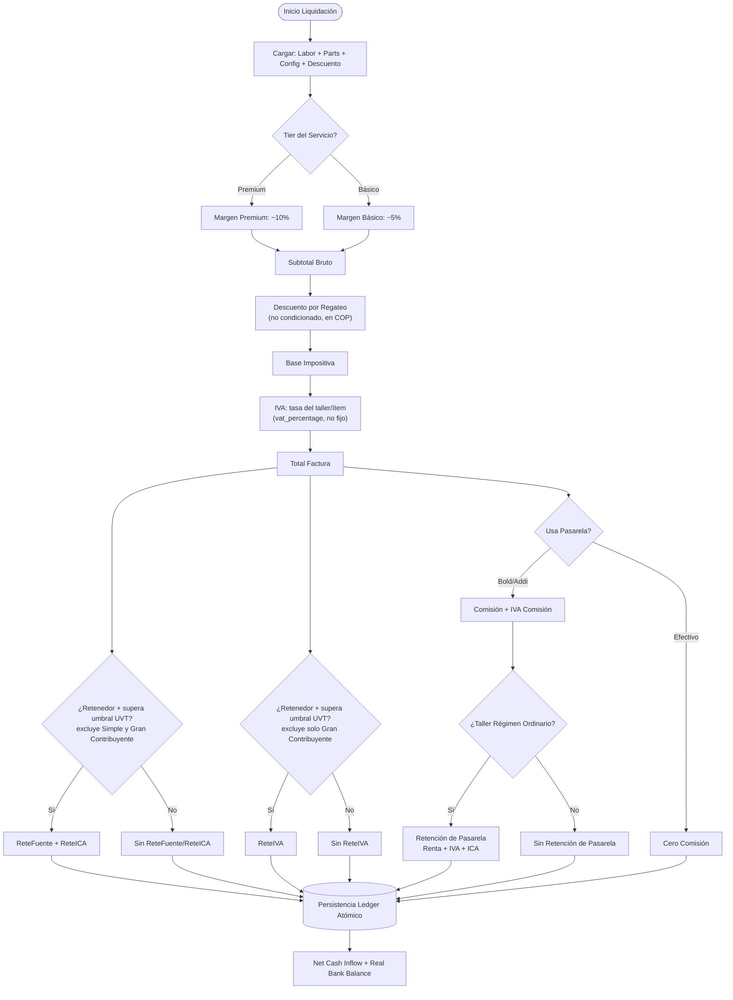

# Motor Financiero — Liquidación y Fórmulas

> Ver también: [README](../README.md) · [ARCHITECTURE-OVERVIEW](../arquitectura/architecture-overview.md) · SECURITY-MODEL · SECURITY-HARDENING-HISTORY · API-REFERENCE · ENVIRONMENT-AND-DEPLOYMENT · [TESTING-AND-MONITORING](../ingenieria/testing-and-monitoring.md) · [RECEPTION-AND-QUOTES](../negocio/reception-and-quotes.md) · [WORK-ORDERS-AND-BAYS](../negocio/work-orders-and-bays.md) · [INVENTORY-AND-PROVIDERS](../negocio/inventory-and-providers.md) · [WORKSHOP-CONFIG-AND-PRICING](../negocio/workshop-config-and-pricing.md) · [LEDGER-AND-ACCOUNTING](./ledger-and-accounting.md) · [WORKSHOP-FINANCE-DASHBOARDS](./workshop-finance-dashboards.md) · [GROWTH-AND-SUBSCRIPTION-BILLING](../comercial/growth-and-subscription-billing.md)

---

## Matriz de Decisión de Liquidación

Las retenciones del cliente (ReteFuente+ReteICA y ReteIVA) y el impacto de la pasarela (comisión + su propia retención) son **ramas independientes** que se restan por separado del Total Factura — ninguna depende de la otra (`netCashInflow = totalFactura - (comisión + IVA comisión + reteIca + reteFuente + reteIva + retención pasarela)`).



---

## 1. Liquidación de servicios (`liquidateClientInvoice`)

```
Subtotal Bruto  = Mano de Obra × (1 + margen%) + Repuestos (con margen)
Descuento       = descuento_monto, recortado a [0, Subtotal Bruto]
Subtotal Neto   = Subtotal Bruto − Descuento         (= Base Impositiva)
IVA             = Subtotal Neto × vat_percentage     (si is_responsable_iva)
Total Factura   = Subtotal Neto + IVA
```

`vat_percentage` es la tasa real configurada por el taller (no un 19% fijo — el default solo aplica si el campo no está configurado). El resultado expone esta misma tasa en `financial_summary.general_vat_rate_pct` para que el ítem de mano de obra de la factura Dataico (`billing.controller.js`) la reuse en vez de un 19 hardcodeado — antes divergían para talleres con IVA configurado ≠ 19% (bug corregido en rev. 25, ver `InformeLoQueFalta.txt`).

**"El default solo aplica si el campo no está configurado" — bug real corregido (2026-09-15, reportado por el usuario: "en cotización a todos les está apareciendo con IVA viendo que muchos talleres no cobran iva")**: `generalVatRate` usaba `Number(config.vat_percentage) || (IVA_RATE*100)` — con `||`, un taller "No Responsable de IVA" (`vat_percentage: 0`, ver `ContadorInventario.jsx`) se trataba igual que uno sin configurar, y caía igual al 19% por defecto. En `liquidateClientInvoice`/`ModalLiquidacion.jsx` esto nunca llegó a cobrarse mal en la factura real, porque el `if (is_responsable_iva)` que envuelve todo el cálculo de IVA ya impedía que un taller sin IVA entrara ahí — pero **Cotizaciones.jsx no tenía ese mismo gate** (`estimateQuoteVat` no miraba `is_responsable_iva` en absoluto), así que el estimado de IVA en una cotización sí se mostraba de más a cualquier taller sin IVA, mano de obra y repuestos incluidos. Corregido en los tres archivos: `??` en vez de `||` (respeta un 0 legítimo) y `estimateQuoteVat` ahora también gatea por `is_responsable_iva`, devolviendo IVA $0 igual que la factura real cuando el taller no es responsable.

**`total_invoice` ahora se persiste, no solo se usa para armar el ledger (2026-09-13, pedido explícito del usuario)**: hasta entonces `financial_summary.total_invoice` (Total Factura de la fórmula de arriba) era puramente transitorio — se calculaba en cada `settleOrder` y quedaba repartido entre varias filas de `cash_flow_ledger`, sin ninguna columna propia que lo guardara entero. `settleOrder` ahora también lo escribe en `work_orders.invoice_total` (migración `2026-09-13_work_orders_invoice_total.sql`), justo después de calcular `results` — igual para contado y crédito, porque la venta se liquida por el Total Factura completo sin importar cómo se cobre después. Es lo que alimenta la columna "Monto" del Historial de Servicios, ver [OPERATIONS.md — Bahías](../negocio/work-orders-and-bays.md#bahías-órdenes-de-trabajo).

### Exención de IVA puntual por cotización/orden (feature, 2026-09-17, pedido explícito del usuario)

> **Reemplazada el 2026-09-29**: la exención real ya no existe; ver "Ocultar IVA al cliente" más abajo. Se deja la descripción como historial.

`taxExemptOverride` (8º parámetro de `liquidateClientInvoice`, default `false`, mapeado 1:1 a `work_orders.tax_exempt_override`) fuerza `vatValue = 0` en el cálculo — `if (config.is_responsable_iva && !taxExemptOverride)` — **sin tocar `config.is_responsable_iva`**, que sigue intacto para todo lo demás. Botón nuevo en Cotizaciones/Bahía para marcar una venta puntual como exenta de IVA (ej. cliente con exención legal), detalle completo del flujo y el botón en [OPERATIONS.md — Cotizaciones](../negocio/reception-and-quotes.md#cotizaciones-cotizaciones).

**Por qué no se tocó `config.is_responsable_iva` directamente**: el pedido original era que el botón cambiara `workshop_config.fiscal_regime` a `no_iva` globalmente (como en el panel del Contador) y lo restaurara al presionarlo de nuevo — descartado porque `is_responsable_iva` se lee EN VIVO y GLOBAL para todo el taller, tanto acá como en `estimateQuoteVat` (`Cotizaciones.jsx`) y en `retentionMatrix.resolveRetentionRule('gateway', config)` (líneas 290 y siguientes, más abajo) — cambiarlo, aunque fuera unos segundos, habría afectado cualquier otra cotización/factura en curso en el mismo taller, y habría apagado por error las retenciones de pasarela Bold/Addi (que dependen del régimen REAL del taller, no de si un cliente puntual está exento de IVA). `taxExemptOverride` en cambio solo gatea el bloque de `vatValue` de esta función — ReteFuente/ReteICA del cliente no dependen de `is_responsable_iva` (no cambian), y ReteIVA cae solo a $0 porque depende del IVA generado (`vat > 0`).

`billing.controller.js:settleOrder` reusa el mismo criterio (`order.tax_exempt_override === true`) para los ítems de la factura electrónica Dataico (`laborVatPct`, `vatPercentage` de cada repuesto) — sin esto, la factura real ante la DIAN habría seguido mostrando IVA por línea aunque el total ya liquidado acá fuera $0, contradiciendo el propio documento.

### Ocultar IVA al cliente, solo visual (feature, 2026-09-29, pedido explícito del usuario)

**No es la exención de arriba.** El requerimiento ("Mantenimiento Contable vs. Vista Comercial de IVA") detectó que la exención se estaba usando para "no mostrarle el IVA al cliente", y eso borraba el IVA generado de la contabilidad y del cruce con el IVA descontable de compras. Regla nueva, con decisiones explícitas del usuario:

- ~~Los dos botones conviven~~ (así quedó primero; el mismo día se quitó la exención real, ver la actualización al final de esta sección). Botón **"Ocultar IVA al cliente"** (`quotes.vat_hidden` → `work_orders.vat_hidden`, migración `2026-09-29_vat_hidden.sql`; `PATCH /api/quotes/:id/vat-hidden` y `PATCH /api/work-orders/:id/vat-hidden`, este último con el mismo gate `canEditPricing` y el mismo bloqueo tras `ready_to_invoice` que tenía la exención).
- **IVA incluido en el precio** (el usuario eligió esto frente a "IVA encima sin mostrar"): el cliente paga el precio pactado y el IVA sale de adentro. `liquidateClientInvoice(..., vatIncluded)` calcula el IVA normal por línea (M.O. a la tasa general, cada repuesto a la suya) y reduce TODAS las bases por `vat_included_ratio = base / (base + IVA)` antes de umbrales y retenciones. Ej.: servicio de $100.000 al 19% → el cliente paga $100.000; ingreso $84.034 + IVA generado $15.966. El régimen del taller, el IVA generado (`TAX_IVA`), las retenciones y la factura electrónica DIAN quedan intactos (Dataico recibe las bases escaladas por el mismo factor).
- **Máscara comercial** (`backend/utils/vatMask.js`): el comprobante de venta (PDF por WhatsApp/Telegram/Email y descarga), el mensaje de "valor del servicio" y la vista del comprobante en `ModalLiquidacion.jsx` muestran cada línea con el IVA adentro y un total único, sin la fila del IVA (`totals.vatHidden` en `saleReceiptTemplate.js`). La cotización no se le envía al cliente, así que en su tarjeta el taller ve "Total al cliente" y aparte "IVA incluido, no se le muestra al cliente".
- **Espejos del cálculo** que tienen que decir lo mismo: `ModalLiquidacion.jsx:visualPreview` (que además lee la marca vieja `tax_exempt_override` como IVA oculto), `Cotizaciones.jsx:withVatIncluded` y `utils/orderPricing.js:estimateInvoiceBreakdown`.
- Tests: `financialEngine.test.js` ("IVA incluido"), `vatMask.test.js`, `billing/billing.settleOrder.vatHidden.test.js`.
- **No cubierto todavía**: la Nota Crédito (devolución) de una venta con IVA oculto sí discrimina su IVA en el PDF.
- **Actualización del mismo día — la exención real se eliminó** (pedido explícito del usuario, tras ver que un taller de prueba liquidó FV-50 y FV-51 con "Exenta de IVA" y quedaron SIN línea `TAX_IVA`): ya no hay botón "Marcar exenta de IVA" en Cotizaciones ni en Bahía; queda solo "Ocultar IVA al cliente". La marca vieja `tax_exempt_override` se lee igual que `vat_hidden` en todo el cálculo (`utils/vatMask.js:isVatHidden`, espejo en `Cotizaciones.jsx` y `ModalLiquidacion.jsx`), así una cotización u orden en curso que quedó marcada como exenta se liquida con IVA incluido y oculto, nunca sin IVA; el motor recibe `taxExemptOverride = false` y la factura DIAN siempre lleva el IVA del régimen. `PATCH .../vat-hidden` limpia la marca vieja. Los endpoints `.../tax-exempt` siguen existiendo por compatibilidad, sin botón. Las ventas ya liquidadas como exentas **no se tocaron** (decisión del usuario; si el contador necesita su IVA, lo ajusta con una nota contable).

### Descuento por regateo (feature, 2026-08-16, pedido explícito del usuario)

Descuento comercial NO condicionado, en pesos COP (`descuento_monto`, campo editable en `ModalLiquidacion.jsx`, default $0), aplicado sobre el Subtotal Bruto (mano de obra + repuestos) de la factura completa — el caso típico del regateo de último momento en un taller mecánico. Según normativa DIAN, un descuento comercial no condicionado reduce la base gravable de **todo el documento** (IVA y retenciones), a diferencia de uno condicionado/financiero, que no la afecta — `liquidateClientInvoice` solo modela el primer caso.

`discountAmount` (7º parámetro, default `0` — si no se manda o es `$0`, el flujo es matemáticamente idéntico al de antes de este feature) se recorta a `[0, Subtotal Bruto]` — nunca negativo, nunca deja el Subtotal Neto por debajo de $0. El descuento se prorratea (`discount_ratio = Subtotal Neto / Subtotal Bruto`) entre la mano de obra y cada repuesto **antes** de calcular su IVA — así una factura con repuestos a tasas distintas (0%/5%/19%, `item.vat_percentage` congelado en `service_inventory_items`) sigue cobrando el impuesto real por ítem sobre su porción ya descontada, en vez de aplicar el descuento a ciegas sobre un IVA general único.

`labor_price`/`inventory_base` (el desglose que ya usaban las líneas de factura Dataico y el CRÉDITO a Ingresos del ledger) siguen expuestos en BRUTO, sin descuento — el motor agrega por separado `subtotal_bruto`, `discount_amount` y `discount_ratio` en `financial_summary`, para que `billing.controller.js:settleOrder` pueda:
- Insertar el CRÉDITO a Ingresos (`puc_income_code`/`puc_parts_income_code`) por el 100% del Subtotal Bruto, sin tocarlo — la trazabilidad del valor real de mano de obra/repuestos queda intacta.
- Insertar un DÉBITO nuevo a Descuentos en Ventas (`puc_descuento_ventas_code`, default `417595`, grupo PUC 4175 — configurable en `ContadorPanel.jsx` igual que el resto de cuentas PUC) por `discount_amount`, tipo de asiento `SALES_DISCOUNT` — contra-ingreso que resta del bruto de arriba. Solo se inserta si `discount_amount > 0` (regla de no-regresión: sin descuento, ni la línea existe).
- Prorratear `discount_ratio` en los ítems que se mandan a Dataico (`invoiceItems`), porque la factura electrónica arma su propia base sumando `price` por ítem — sin este prorrateo, la DIAN recibiría el Subtotal Bruto mientras el ledger interno liquidó sobre el Subtotal Neto.

`SALES_DISCOUNT` se agregó a `NON_CASH_TYPES` (no es un segundo movimiento de caja — su efecto ya está en el `net_amount` reducido de `CASH_RECEIPT`/`AR_RECOGNITION`) y a `COST_TYPES` (para que `calculateOperatingProfit` lo reste de la Utilidad Neta, igual que `INV_COGS`/`MECH_COMMISSION`) — mismo espejo de siempre entre `backend/utils/financialEngine.js` y `frontend/src/utils/ledgerLabels.js`.

**Bug real corregido durante la implementación**: `billing.controller.js` repartía el CRÉDITO de las líneas de ingreso (`laborShare`) dividiendo `labor_price` entre `base_impositiva` — antes de este feature esa base era igual al Subtotal Bruto, así que el bug era invisible; en cuanto `base_impositiva` pasó a ser el Subtotal Neto (más chico en cuanto hay descuento), `laborShare` se inflaba por encima de 1 y la porción de repuestos se volvía negativa. Corregido a dividir por `subtotal_bruto` explícito. Cubierto por `tests/billing/billing.settleOrder.discount.test.js` (sin descuento, con descuento, y descuento mayor al Subtotal Bruto — recortado al 100%, orden "gratis" sigue cuadrando en partida doble).

### Margen de mano de obra por Gama/Complejidad (rev. 49)

El "margen%" de la fórmula de arriba es `service_catalog.base_margin_basic`/`base_margin_premium` — un número guardado por servicio, elegido libremente por el taller al crear/editar el catálogo. Desde rev. 49, el formulario ("Crear Servicio" en `/config`) sugiere ese número en vez de dejarlo en blanco, a partir de dos clasificadores nuevos por servicio (`gama`, `complejidad`, cada uno `'Alta'`\|`'Baja'`) y la tabla oficial del documento fuente (*"Proyecto recortado para el Producto minimo viable .txt"*, líneas 68-73) — 4 combinaciones documentadas de 8 posibles:

| Tier | Gama | Complejidad | Rango | Sugerido |
|:---|:---:|:---:|:---:|:---:|
| Premium | Alta | Alta | 60%–45% | 50% |
| Premium | Baja | Alta | 60%–45% | 50% |
| Básico  | Alta | Baja | 60%–45% | 50% |
| Básico  | Baja | Baja/Media | 55%–40% | 45% |

Las 4 combinaciones no documentadas (p. ej. Básico+Alta+Alta) caen al default explícito de 45% con rango 40%-55% — mismo criterio que ya usaba `getServiceMargin` antes de tener UI. Implementación mirror en dos archivos (mismo patrón que `NON_CASH_TYPES`, ver [ARCHITECTURE.md](../arquitectura/architecture-overview.md)): `backend/utils/pricing.js` (`getServiceMargin`/`getServiceMarginRange`, con tests en `backend/tests/pricing.test.js`) y `frontend/src/utils/pricingTiers.js` (mismas funciones, para calcular la sugerencia sin round-trip al servidor). `gama`/`complejidad` **no** participan en la liquidación real (`liquidateClientInvoice`/`billing.controller.js`/`workOrders.controller.js` siguen leyendo directo `base_margin_basic`/`base_margin_premium`) — son solo metadata de UI para no tener que memorizar la tabla cada vez que se crea un servicio; el usuario puede sobrescribir el número sugerido a mano.

No confundir con otros dos conceptos que reusan las mismas palabras: la "gama" de marca de vehículo (`Alta`/`Normal`, ver `vehicleClassifier.assignServiceTier`, decide el tier Premium/Básico de una *orden*) y la "complejidad" de orden (`service_complexity`, escala `baja`/`media`/`alta` en `work_orders`, elegida en Bahía al crear la orden). La `gama`/`complejidad` de esta sección son un tercer concepto, estático por servicio del catálogo, sin relación con esos dos.

```
Si clientIsRetainer AND supera umbral UVT:
  ReteFuente = Base × retefuente_rate_declarante   (exento: Simple, Gran Contribuyente)
  ReteICA    = Base × (reteica_rate / 1000)        (exento: Simple, Gran Contribuyente)
  ReteIVA    = IVA  × reteiva_rate                 (exento: solo Gran Contribuyente)

Pasarela Bold presencial:
  tarjeta_nacional     → 2.99% + $300
  tarjeta_internacional → 3.99% + $300
  qr_billetera         → 1.50%

Pasarela Bold online:
  tarjeta_nacional     → 3.49% + $900
  tarjeta_internacional → 4.49% + $900
  qr_billetera         → 1.50%

Pasarela Addi: gateway_addi_rate / 100
IVA sobre comisión = Comisión × 0.19

Retención de la PASARELA sobre el giro (solo Régimen Ordinario, ver abajo):
  ReteRenta = Base × gateway_reterenta_rate  [default 1.5%]
  ReteIVA   = IVA  × reteiva_rate            [mismo 15% que la retención del cliente]
  ReteICA   = Base × (gateway_reteica_rate / 1000)  [default 0.4‰... 4/1000 = 0.4%]

Net Cash Inflow = Total − ReteFuente − ReteICA − ReteIVA − Comisión − IVA comisión
                  − ReteRenta pasarela − ReteIVA pasarela − ReteICA pasarela
```

**Bug real corregido en rev. 40 — preview de `ModalLiquidacion.jsx` no incluía el IVA sobre la comisión**: el motor resta `commission + commissionVat` de `netCashInflow` (expuesto como `gateway_impact.total_gateway_cost`), pero el preview del frontend solo calculaba `gatewayFee` (la comisión base) y la restaba de `net` — nunca calculaba el 19% de IVA sobre esa comisión. El cajero veía un "Total Neto a Recibir" más alto que el que `settleOrder` realmente liquidaba al cobrar por Bold/Addi. Corregido agregando `gatewayFeeVat = gatewayFee × 0.19` (mismo 19% fijo que usa el backend para esta línea, no `config.vat_percentage`) al cálculo de `net`; la línea "Comisión Plataforma" del desglose ahora muestra el costo total real (`gatewayFee + gatewayFeeVat`).

### Matriz de retenciones taller × cliente en ventas (rev. 38)

Reescrita dos veces sobre la misma celda:

- **rev. 34**: se descubrió que ReteICA usaba la misma guarda que ReteFuente/
  ReteIVA (`workshopCanWithhold = is_agente_retenedor_renta` del TALLER) —
  pregunta correcta para compras (quien retiene es el comprador), pero
  equivocada para ventas (quien retiene es el CLIENTE que paga). Se agregó
  una rama especial para Régimen Simple basada en el régimen del cliente,
  confirmada contra una imagen ("Matriz Maestra de Aplicación") que el
  usuario proveyó en ese momento.
- **rev. 38**: el usuario trajo un segundo set de imágenes
  (`Taller_cliente1/2.jpg`) que contradecía la anterior en varias celdas. Se
  investigó contra el Estatuto Tributario real (Decreto 1091 de 2020, Art.
  911 y 437-2 ET) antes de tocar código, y se confirmó que la matriz de
  rev. 34 estaba **incompleta**: el Art. 911 exime al Régimen Simple de
  ReteFuente **e ICA** ("mas no de retención a título de IVA" — Decreto
  1091/2020), sin importar el régimen del cliente — la distinción
  Ordinario/Gran Contribuyente del cliente que introdujo rev. 34 no existe
  en la norma real. Además, un Gran Contribuyente es **autorretenedor** —
  nunca le retienen nada al vender (el mismo principio que ya aplicaba
  correctamente cuando es proveedor, ver más abajo), algo que rev. 34 no
  contemplaba (trataba Gran Contribuyente igual que Ordinario). Por último,
  "No Responsable de IVA" no tiene ninguna exención de ReteFuente/ReteICA —
  esa es una condición sobre el IVA que cobra, no sobre renta/ICA.

| Régimen del Taller | ReteFuente | ReteICA | ReteIVA |
|:---|:---:|:---:|:---:|
| No Responsable de IVA | SÍ (si cliente agente retenedor + umbral) | SÍ | $0 natural (no genera IVA) |
| Régimen Simple | **NO** (Art. 911) | **NO** (Art. 911 + Decreto 1091/2020) | SÍ (si cliente agente retenedor + umbral) |
| Régimen Ordinario | SÍ | SÍ | SÍ |
| Gran Contribuyente | **NO** (autorretenedor) | **NO** (autorretenedor) | **NO** (autorretenedor) |

El régimen del **cliente** (Ordinario vs. Gran Contribuyente) ya NO cambia el
resultado en ninguna fila — solo importa si el cliente está marcado como
agente retenedor (`clientIsRetainer`). Por eso `classifyClientRegime` (rev.
34) se eliminó del motor: dejó de tener uso. Reproducido originalmente con
datos reales del taller `77f4ea4b-...` (rev. 34) y revisado exhaustivamente
con tests para las 4 filas × ambos valores de `clientIsRetainer` (rev. 38, ver
[TESTING.md](../ingenieria/testing-and-monitoring.md)). Mismo fix replicado en el preview de
`ModalLiquidacion.jsx` y en el simulador sin caller activo
`useFinancialStore.calculateLiveInvoice` (frontend) — ver también el bug del
IVA de la comisión de pasarela en ese mismo preview, corregido en rev. 40
(arriba, sección de Pasarela).

### Venta a crédito a un cliente agente retenedor — Cartera debe reconocer el NETO, no el bruto (2026-08-01, bug real corregido)

**Bug real corregido, bloqueaba la operación por completo**: `billing.controller.js:settleOrder` insertaba `AR_RECOGNITION` (Cartera reconocida, 130505) por `results.financial_summary.total_invoice` — el total BRUTO de la factura, sin descontar las retenciones que el cliente practica (`RET_FUENT`/`RET_IVA`/`RET_ICA`, ver matriz arriba). Cuando ambas condiciones coincidían (venta a crédito + cliente agente retenedor con retenciones > 0), el comprobante quedaba descuadrado por exactamente la suma de las retenciones — `documentNumbering.js:assertBalanced` (validación agregada 2026-07-30) rechazaba el insert con 500 "Comprobante descuadrado", así que **ninguna venta a crédito a un cliente agente retenedor podía liquidarse**, sin excepción. Confirmado empíricamente con un caso real: DEBIT $770.750 vs CREDIT $724.750, diff $46.000 = exactamente RET_FUENT+RET_IVA+RET_ICA de ese caso.

La causa raíz es conceptual, no solo aritmética: lo que el cliente REALMENTE queda debiendo es el total menos lo que retuvo — esa plata retenida nunca la va a pagar al taller, la remite directo a la DIAN (el taller ya la reconoció aparte como activo propio en las líneas `RET_FUENT`/`RET_IVA`/`RET_ICA`, DEBIT a las cuentas de anticipo 135515/135517/135518). Contarla también en Cartera la duplicaba.

Corregido usando `results.financial_summary.net_cash_inflow` (el mismo neto que ya usaba la rama de venta de contado para `CASH_RECEIPT`) también para `AR_RECOGNITION` en la rama de crédito. Las cuotas generadas (`client_installments`, `installmentsUtil.splitIntoInstallments`) también repartían el bruto — corregido a repartir el mismo neto, para que la suma de las cuotas coincida exacto con lo que la Cartera dice que el cliente debe y pagarlas todas cruce el saldo a $0. Cubierto por un test nuevo en `tests/billing.settleOrder.pucAccounts.test.js` ("venta a crédito a un cliente agente retenedor no queda descuadrada").

Ninguno de los dos talleres de prueba auditados había llegado a ejercitar esta combinación todavía (por eso nunca se había visto fallar en producción) — es un bug de código, no de datos, así que no hizo falta ningún backfill.

### Retención de la Pasarela sobre el giro al taller (rev. 38)

Bold/Addi actúan como agentes de retención **independientes del cliente**
sobre el giro que le hacen al taller (verificado contra el decreto de
retención en pagos electrónicos y el Art. 401-4 ET — Wompi lo confirma en su
propio centro de ayuda): 1.5% de renta sobre la base, 15% del IVA generado
(mismo `reteiva_rate` de arriba), e ICA propio de la actividad financiera
(`gateway_reteica_rate`, default 0.4‰ — **distinto** de la tarifa general de
servicios ~0.966‰ usada arriba para el ICA que practica el cliente).

| Régimen del Taller | ¿Sufre retención de pasarela? |
|:---|:---:|
| No Responsable de IVA | NO (Art. 401-4 — exención específica de quien no cobra IVA) |
| Régimen Simple | NO (Art. 911) |
| Régimen Ordinario | **SÍ**, las 3 (ReteRenta + ReteIVA + ReteICA) |
| Gran Contribuyente | NO (autorretenedor) |

Es independiente de `clientIsRetainer` (la practica la pasarela, no el
cliente), así que puede **coexistir** con la matriz de arriba si el cliente
además es agente retenedor y paga por Bold/Addi — ambas retenciones se restan
del `net_cash_inflow`. Se registra en el ledger como 3 tipos nuevos
(`GW_RET_RENTA`/`GW_RET_IVA`/`GW_RET_ICA`, informativos, cuenta PUC
`puc_pasarela_retencion_code` — ver tabla de tipos de movimiento abajo).
Configurable por el contador en `ContadorInventario.jsx` (sección "Tasas de
Pasarelas Externas").

**Venta a crédito**: `INC_GROSS.net_amount = 0` al liquidar (el ingreso operativo, base sin IVA, se reconoce completo en ese momento); ingresos reales de caja entran vía `payInstallment` (backend), que inserta un segundo asiento `INC_GROSS` por cada cuota cobrada con `net_amount = gross_amount` = valor de la cuota **con IVA incluido** — correcto para caja real (`bankBalance`), pero **no** debe sumarse otra vez al ingreso operativo: ya se reconoció al liquidar. El frontend (`FlujoCaja.jsx`) identifica esos asientos de cobro por su concepto fijo (`"Cuota N/M — ..."`, único texto que arma `payInstallment`) y los excluye del cálculo de Utilidad Neta (bug corregido: antes se sumaban también ahí, duplicando la venta e inflándola con IVA). Ver el flujo funcional completo en [FINANCE.md — Panel de Cobros](./workshop-finance-dashboards.md#panel-de-cobros-cobros).

---

## 2. Liquidación de compras (`liquidateSupplierPurchase`)

```
Base          = total_gross_cost / (1 + 0.19)
IVA de Compra = total_gross_cost − Base

GMF (payment_method='banco' AND apply_4x1000=true):
  GMF = total_gross_cost × 0.004

Net Outflow = total_gross_cost − ReteFuente − ReteICA − GMF
```

Si proveedor NO es responsable de IVA (`is_responsible_vat=false`): el total facturado no trae IVA embebido, Base = total_gross_cost (sin dividir por 1.19). Si la factura trae un IVA explícito (OCR o corregido a mano, `invoiceVatAmount`), ese manda sobre el derivado.

### Matriz de retenciones taller-comprador × proveedor

Reescrita 3 veces sobre la misma tabla:

- Antes de esta sesión: todo-o-nada (las 3 retenciones aplicaban juntas o
  ninguna, según solo si ambos eran Gran Contribuyente — `Correcion.txt:40`).
- Fase 2 de la sesión: se separó en `appliesReteFuente`/`appliesReteIcaReteIva`,
  con el criterio "el proveedor Gran Contribuyente nunca se retiene
  (autorretenedor)", y se permitió a un taller Gran Contribuyente retener
  ICA+IVA (sin ReteFuente) a un proveedor Régimen Simple.
- **rev. 38**: investigado contra Decreto 1091/2020 y Art. 437-2 ET, se
  encontraron 2 problemas más finos: (1) ReteICA y ReteIVA NO comparten la
  misma exención — el Art. 911 protege al proveedor Régimen Simple de ReteICA
  **sin importar el régimen del comprador** (la excepción que Fase 2 le daba
  a Gran Contribuyente no existe en la norma real), y (2) un comprador
  simplemente Ordinario NO es agente retenedor de IVA frente a OTRO Ordinario
  (Art. 437-2: esa calidad es de los Grandes Contribuyentes, "sean o no
  responsables del IVA") — el código aplicaba ReteIVA en ese caso por error,
  bundleada con ReteICA. Ahora son 3 flags totalmente independientes:

| Taller comprador ↓ / Proveedor → | Ordinario / Persona Natural | Régimen Simple | Gran Contribuyente |
|:---|:---:|:---:|:---:|
| No responsable / Simple | Ninguna | Ninguna | Ninguna |
| Ordinario | ReteFuente + ReteICA (si supera el tope UVT de compras). ReteIVA **NO** ("entre ordinarios") | ReteFuente/ReteICA **NO** (Art. 911). ReteIVA **SÍ**, obligatoria (Art. 437-2, retención especial a proveedores RST) | Ninguna (autorretenedor) |
| Gran Contribuyente | ReteFuente + ReteICA + ReteIVA (comprador Gran Contribuyente sí es agente retenedor de IVA, Art. 437-2) | ReteFuente/ReteICA **NO** (Art. 911). ReteIVA **SÍ** | Ninguna (autorretenedor) |

```
ReteFuente: declarante → Base × (supplier_retefuente_rate / 100)     [default 2.5%]
            no declarante → Base × (retefuente_rate_no_declarante / 100) [default 3.5%]
ReteICA:   Base × (reteica_rate_supplier / 1000 si el proveedor tiene tasa propia,
                    si no config.supplier_reteica_rate / 1000)       [default 9.66‰]
            — misma exención que ReteFuente (Art. 911 protege ambas)
ReteIVA:   IVA × (config.reteiva_rate / 100)                         [default 15%]
            — aplica si el comprador es Gran Contribuyente O el proveedor es
              Régimen Simple (o ambos); NUNCA si el proveedor es Gran
              Contribuyente (autorretenedor)
```

`supplier_retefuente_rate` y `supplier_reteica_rate` (contador → `ContadorInventario.jsx`) se leen `/100`/`/1000` igual que el resto de tasas del sistema — antes `supplier_retefuente_rate` se leía como fracción cruda, así que guardar "2.5" (como las demás columnas) habría dado una retención del 250% (bug corregido en rev. 25). `reteiva_rate` en compras usaba un `RETEIVA_MULTIPLIER` fijo (15%) ignorando la tasa configurable del contador — bug corregido en rev. 34, ahora se lee igual que en ventas (`config.reteiva_rate`). Todas las tasas configurables de este módulo (incluidas `retefuente_rate_declarante`, `reteica_rate`, `gateway_addi_rate`) comparan contra `null`/`undefined` explícito, no `|| default` — un 0% real configurado por el contador se respeta en vez de caer al default.

**Bug real corregido en rev. 48 — el propio umbral UVT tenía el mismo problema**: `uvtValue`/`partsThresholdUvt` (`liquidateSupplierPurchase`) y `uvtValue`/`serviceThresholdUvt` (`liquidateClientInvoice`) se leían con `Number(config.x) || default` — un valor guardado en 0 UVT (para retener siempre, sin importar el monto) se habría visto silenciosamente pisado de vuelta al default (10 o 2 UVT). Corregido a `config.x != null ? Number(config.x) : default` en las 4 lecturas, mismo criterio que ya usan las tasas de arriba. (Desde 2026-09-02 estas 3 columnas de `workshop_config` ya no se pueden editar — ver la nota al inicio de este documento —, pero la lectura sigue siendo `!= null` porque financialEngine.js sigue soportando el caso NULL igual que antes; el `|| default` seguiría siendo el bug real si alguna vez se reactivara la edición.)

**Diagnóstico real de un caso reportado (rev. 48)**: una compra taller-Ordinario → proveedor-Ordinario no generó ReteFuente/ReteICA pese a superar cómodamente el umbral UVT. La matriz en sí calculó bien — el gate real (`workshopCanWithhold = config.is_agente_retenedor_renta === true`) estaba en `false` porque el taller nunca había guardado de verdad "Régimen Ordinario" en el panel del Contador (consulta directa a la BD real confirmó los 4 talleres existentes en `fiscal_regime='no_iva'`). Causa de la confusión: `ContadorInventario.jsx`/`Config.jsx` inicializaban su estado local con `fiscal_regime: 'ordinario'` antes de cargar los datos reales — el panel podía mostrarse como si ya estuviera configurado sin estarlo (corregido el default a `'no_iva'`, el mismo que usa `auth.controller.js:register`). Ver también el Frente 4 de `InformeLoQueFalta.txt` (rev. 48): el mismo panel tenía además un bug de `localStorage['user']` obsoleto que probablemente impedía guardar el cambio de régimen del todo.

**Segundo caso real confirmado (2026-09-02)**, esta vez NO un bug: al probar el flujo de "Gasto de Software" (`admin.controller.js:uploadSoftwareInvoice`, ver [BILLING.md](../comercial/growth-and-subscription-billing.md#talleres)) con el un taller de prueba, una compra de $600.000 (base ≈10 UVT, por encima del default de 10) dio ReteFuente/ReteICA/ReteIVA en $0. Causa confirmada contra la BD real: `fiscal_regime = 'no_iva'` para ese taller → `REGIME_MAP` (`workshop.controller.js`) deriva `is_agente_retenedor_renta = false` automáticamente para ese régimen, así que `workshopCanWithhold` nunca llega a evaluarse — el propio selector de Régimen en `ContadorInventario.jsx` ya avisa esto en su descripción ("No cobra IVA. Sin retenciones."). Mismo síntoma (retención en $0) que el caso de rev. 48 de arriba, causa distinta (config correcta, no un bug) — sirve como referencia rápida para diagnosticar el próximo reporte similar: primero revisar `is_agente_retenedor_renta`/`fiscal_regime` del taller antes de sospechar de la matriz o del umbral UVT.

> Nota de simplificación: la retención especial de IVA a proveedores del Régimen Simple tiene, en la norma real, sus propios topes UVT (27 UVT bienes / 4 UVT servicios, fijados por el Art. 437-2 y no afectados por el Decreto 572/2025) — EFISCO reutiliza por simplicidad el mismo `retention_threshold_parts_uvt` configurable que ya usa ReteFuente/ReteICA en vez de una columna separada. Si esto genera diferencias prácticas relevantes, es candidato a una columna dedicada en una futura revisión.

**Ojo — Ordinario y Gran Contribuyente (taller comprador) comparten exactamente los mismos 3 booleans** (`is_responsable_iva`, `is_regimen_simple`, `is_agente_retenedor_renta` — ver [WORKSHOP_ONBOARDING.md](../negocio/workshop-config-and-pricing.md#configuración-del-taller-config)); la fila "Gran Contribuyente" de esta matriz se decide con `config.fiscal_regime === 'gran_contribuyente'` (columna de texto aparte), no con esos booleans. Bug corregido en rev. 35: `POST /api/workshop/finance-settings` escribía esos 3 booleans directamente sin sincronizar `fiscal_regime` (a diferencia de `PUT /api/workshop/:id`, que sí lo hace vía un `REGIME_MAP` compartido) — un taller configurado como Gran Contribuyente por esa vía podía quedar con `fiscal_regime` desactualizado y perder la fila especial (ReteICA+ReteIVA a un proveedor Régimen Simple). Ambos endpoints ahora usan el mismo `REGIME_MAP` (hoisted en `workshop.controller.js`) como única fuente de verdad.

### Matriz de retenciones editable por el contador (`retention_matrix_overrides`, 2026-09-16, pedido explícito del usuario)

Las 3 matrices de arriba (Taller × Cliente, Taller × Pasarela, Taller × Proveedor) dejaron de ser `if/else` fijos en el código — el contador puede sobreescribir, celda por celda, si aplica ReteFuente/ReteRenta/ReteICA/ReteIVA en cada combinación, desde el panel del Contador (`ContadorPanel.jsx`). Justificación de negocio del usuario: la norma cambia y pueden existir excepciones puntuales por municipio/empresa que el sistema no contempla en el default legal.

**Modelo de datos**: columna nueva `workshop_config.retention_matrix_overrides` (jsonb, nullable — migración `2026-09-16_workshop_retention_matrix_overrides.sql`), mismo patrón que `category_vat_rates` (JSONB de overrides ya existente, ver [WORKSHOP_ONBOARDING.md](../negocio/workshop-config-and-pricing.md#configuración-del-taller-config)): se guarda a través del mismo `PUT /api/workshop/:id` ya gateado a rol `contador` (`CONTADOR_FIELD_TRANSFORMS`), sin tabla ni ruta ni política RLS nuevas. Es **sparse**: solo existen las celdas que el contador de verdad tocó (`{ client: {"<rowKey>|<colKey>": {retefuente,reteica,reteiva}}, provider: {...}, gateway: {...} }`) — la ausencia de una clave es literalmente el indicador de "sigue en el default legal", no hace falta un campo `is_custom` aparte. "Restablecer a Valores por Defecto del Sistema" en la UI es un `PUT` con `retention_matrix_overrides: null`.

**Resolución centralizada, no `if/else` duplicados**: antes de este cambio, la fórmula de retención de ventas/pasarela estaba duplicada en 4 lugares (`financialEngine.js`, `ModalLiquidacion.jsx`, `Cotizaciones.jsx:estimateQuoteRetentions`, y `useFinancialStore.js:calculateLiveInvoice` sin caller activo). Se extrajo a un módulo puro nuevo por lado — `backend/utils/retentionMatrix.js` y su espejo `frontend/src/utils/retentionMatrix.js` (mismo contenido, dos bundles distintos no pueden compartir el archivo) — que expone `resolveRetentionRule(dynamic, config, colArg)`: deriva la fila (régimen del taller) y columna (agente retenedor del cliente / régimen del proveedor / única para pasarela) del `config` real, busca el override guardado y si no existe calcula el MISMO default que ya estaba verificado con tests (movido, no reescrito). `financialEngine.js:liquidateClientInvoice`/`liquidateSupplierPurchase` y los 3 sitios activos del frontend ahora llaman esta única función — un override del contador se refleja igual en la cotización, en el preview de liquidación y en la factura final, sin que ninguna copia quede desincronizada.

**(Actualizado 2026-09-26: el UVT y los topes volvieron a ser editables, ver abajo)** **El umbral UVT sigue sin ser editable** (ni por esta vía ni por ninguna otra, ver la nota al inicio de este documento sobre por qué se le quitó esa opción al contador el 2026-09-02) — se aplica POR ENCIMA de lo que diga la matriz: una celda en "Sí" solo genera retención real si además la base supera el umbral legal vigente. Esto evita el mismo riesgo que ya se vivió con el UVT (talleres reales quedando retenyendo con una regla vieja tras un cambio de norma, sin darse cuenta): la matriz de exenciones/aplicabilidad SÍ es editable porque es una necesidad de negocio real (excepciones por municipio/empresa), pero el parámetro puramente numérico y nacional (el umbral) sigue centralizado.

**Cobertura de tests**: `backend/tests/financialEngine.test.js` gana un describe "Overrides del contador" (venta) y otro en `liquidateSupplierPurchase` (compra) — 6 tests nuevos verificando las 2 reglas de no-regresión pedidas explícitamente: sin overrides el resultado es idéntico al de siempre, un override a "No" da $0 exacto aunque la tasa (%) siga configurada, un override a "Sí" en una celda normalmente exenta genera retención real, y el umbral UVT sigue mandando aunque la celda esté en "Sí". Los 65 tests preexistentes de la matriz (rev. 38, "Fila 1" a "Fila 6") no se tocaron y siguen pasando tal cual — es la prueba de no-regresión más directa que ya existía.

### Compra a plazos — Cuentas por Pagar a proveedores

Espejo exacto de la venta a crédito de clientes (ver más abajo): al registrar una compra con `payment_mode:'credito'` y `num_installments>1`, la cabecera (`supplier_purchases`) queda `status:'pendiente'`, se reparte el pago neto en `supplier_installments` (mismo `installments.js:splitIntoInstallments`, cuotas espaciadas por el intervalo real elegido — ver más abajo), y el asiento `SUP_PAY` inicial lleva `net_amount:0` (reconocimiento del costo, sin salida de caja aún — el costo/gasto ya se causa con el monto bruto). Cada cuota pagada (`PATCH /api/providers/installments/:id/pay`) inserta un nuevo `SUP_PAY` con `net_amount = amount` de la cuota, la salida de caja real. `SUP_PAY` no está en `NON_CASH_TYPES`, así que `cashValue`/`calculateGlobalHealth` excluyen automáticamente los $0 sin ningún cambio adicional al motor — mismo mecanismo que ya usa `INC_GROSS` para crédito a clientes.

**Bug real corregido en rev. 48 — orden no atómico entre el ledger y las cuotas**: `providers.controller.js:registerPurchase` insertaba `supplier_installments` (que puede fallar y hacer `throw`) ANTES del insert del ledger — un fallo ahí (FK, `first_payment_date` inválida, etc.) abortaba la respuesta dejando la cabecera de la compra (`supplier_purchases`) ya comprometida, pero sin NINGÚN asiento en `cash_flow_ledger` — ni siquiera el `SUP_PAY` informativo de `net_amount=0`, invisible por completo en Finanzas/Flujo de Caja. Se reordenó: el ledger se inserta primero, las cuotas después y sin `throw` (solo `console.error` si fallan) — mismo criterio defensivo que ya usa `settleOrder` con `client_installments` ("peor tener una cuenta por pagar sin cuotas generadas, recuperable a mano, que una compra con dinero movido pero invisible en el libro"). Bug secundario del mismo frente: `finance.controller.js:getDashboardSummary` sumaba `SUP_PAY.amount` (el bruto) en vez de `net_amount` para `supplierExpenses` — una compra a plazos se contaba completa al registrarla Y otra vez por cada cuota pagada; corregido a `net_amount`, espejo exacto de cómo ya trata `INC_GROSS`.

**Bug real corregido en rev. 48 — causación invisible en los paneles, aunque bien guardada en la BD**: `finance.controller.js:getDashboardSummary` (`ledgerHistory`) y `getCashFlow` (`entries`) tenían un filtro que ELIMINABA POR COMPLETO cualquier fila `INC_GROSS`/`SUP_PAY` con `net_amount=0` de la lista devuelta al frontend — no solo de las sumas (correcto), sino de la vista entera. Verificado con datos reales de un taller: el asiento existía en `cash_flow_ledger` pero no aparecía ni en Finanzas ni en Flujo de Caja. Se quitó el filtro (los totales/saldo acumulado siguen usando `net_amount`/`cashValue`, así que no se rompe nada) y se agregó distinción visual en el frontend (`ledgerLabels.js:isPendingCausacion`, usado en `FlujoCaja.jsx`/`DashboardFinanciero.jsx`): la fila se muestra con la etiqueta "Causado, pendiente de pago" en vez de con el `+/−` de caja real que sí llevan los movimientos que mueven el banco de verdad. El fix es retroactivo — la causación de compras/ventas a crédito ya registradas antes del fix también se muestra, sin necesidad de volver a registrarlas.

**Cálculo de `due_date` de cada cuota (`billing.controller.js`/`providers.controller.js`, espejo exacto entre clientes y proveedores)**: hasta rev. 47, cada cuota sumaba un mes calendario a la primera con `setUTCMonth`/`getUTCMonth` (anclado al mismo frame UTC en que se parseó `first_payment_date`, sin depender de la zona horaria del servidor) — pero esto asumía siempre "+1 mes" sin importar el intervalo real pactado (ej. primera cuota a 15 días terminaba con la segunda a "15 días + 1 mes" en vez de a 30 días). **Bug real corregido en rev. 48**: se reemplazó por `installments.js:buildInstallmentDueDates(anchorDate, firstPaymentDate, n, explicitDueDates)` — replica por defecto el mismo intervalo en DÍAS entre el ancla (hoy, el momento de la compra/venta) y la primera cuota para las siguientes (con fallback a 30 días si el intervalo es cero o negativo), y respeta un array `due_dates` explícito si el frontend lo manda (el usuario editó las fechas a mano). Espejo exacto en `frontend/src/utils/installments.js` para la sugerencia en vivo del formulario — `ModalLiquidacion.jsx`/`Proveedores.jsx` muestran un input de fecha editable por cada cuota desde la 2ª en adelante, prellenado con el cálculo automático.

### Retenciones de compra en CREDIT, no DEBIT — y `total_outflow` también resta ReteIVA (2026-07-30, pedido explícito del usuario)

**Bug real corregido, encontrado por el validador global de partida doble** (ver [Libro Auxiliar — validación de partida doble](#validación-de-partida-doble-en-el-insert-2026-07-30-pedido-explícito-del-usuario) más abajo): `providers.controller.js:registerPurchase` insertaba `RET_FUENT_COMPRA`/`RET_ICA_COMPRA`/`RET_IVA_COMPRA` en **DEBIT** — contablemente equivocado, porque 236540/236802/236702 son cuentas de **pasivo** (el taller retuvo esa plata del proveedor y se la debe a la DIAN, no es un costo adicional). Con DEBIT, el comprobante quedaba descuadrado por exactamente 2× la suma de retenciones cada vez que aplicaban. Ahora van en CREDIT, igual en `providers.controller.js`, `subscriptionBilling.service.js:recordWorkshopSideExpense` y `admin.controller.js:uploadSoftwareInvoice` (las 3 rutas comparten el mismo patrón de compra a proveedor — EFISCO es "proveedor" de sí misma en las últimas dos).

Un segundo bug, más profundo, apareció al intentar balancear lo anterior: `liquidateSupplierPurchase`'s `total_outflow` (el pago neto real al proveedor) restaba ReteFuente + ReteICA, pero **no** ReteIVA — un `total_outflow` sobrestimado exactamente en el monto de la ReteIVA cada vez que un taller Gran Contribuyente le compra a un Ordinario (o cualquier comprador a un proveedor Régimen Simple). Confirmado con el usuario: la ReteIVA SÍ reduce el pago real (el taller se queda esa plata igual que con ReteFuente/ReteICA, la remite a la DIAN aparte) — corregido a `total − (reteFuente + reteIca + reteIva)`. Afecta el `net_paid_amount` guardado en `supplier_purchases` y el monto real de la contrapartida `CASH_PAYMENT`/`AP_RECOGNITION` del ledger, en las mismas 3 rutas de arriba.

**`recordWorkshopSideExpense`/`uploadSoftwareInvoice` estaban más rotos todavía** — nunca habían registrado `TAX_IVA_DEDUC` ni ninguna línea de retención en el ledger (solo quedaban en las columnas de `supplier_purchases`, invisibles en el Libro Mayor), y jamás traían contrapartida de Caja/Bancos: cada pago de suscripción de EFISCO se guardaba con SOLO el lado DEBIT. Completadas con el mismo patrón ya corregido de `registerPurchase`.

### Validación de partida doble en el insert (2026-07-30, pedido explícito del usuario)

`documentNumbering.js:claimAndInsertLedger` (el único chokepoint por el que pasa TODO insert a `cash_flow_ledger` de todo controller) valida, antes de llamar al RPC, que `SUM(gross_amount ?? amount)` de las líneas `impact='DEBIT'` sea igual (tolerancia de 2 centavos, por redondeo de punto flotante al sumar varios montos ya redondeados) a la de las líneas `impact='CREDIT'` — si no cuadra, lanza un Error y NO se guarda nada. `gross_amount` (con fallback a `amount`) es el mismo campo que ya usa `finance.controller.js:generateLedgerBook` para las columnas Débito/Crédito del Libro Mayor real: sumar por `amount` sin más rompía `INC_GROSS` (que incluye el IVA prorrateado por dentro, contado aparte en su propia línea `TAX_IVA`) marcando como "descuadrado" un comprobante que en realidad cuadraba.

Activar esta validación reveló, además del bug de retenciones de arriba, otros 2 puntos de inserción que ya estaban descuadrados en producción y se corrigieron en la misma revisión:
- `finance.controller.js:addManualMovement` ("Ingreso No Operacional"/"Devolución IVA"): insertaba una sola línea CREDIT sin contrapartida — se agregó `CASH_RECEIPT` (DEBIT, Bancos) como contrapartida.
- `finance.controller.js:recordReferralIncome` ("Ingreso por Referido"): mismo problema, mismo fix (`CASH_RECEIPT` DEBIT).

### Comisión de mecánico y pago de sueldos — partida doble (2026-07-30, pedido explícito del usuario)

- **Causación de comisión** (`billing.controller.js:settleOrder`, type `MECH_COMMISSION`): el DEBIT al gasto (510506) no tenía contrapartida — se agregó un CREDIT a **233525** (Comisiones por Pagar, pasivo), mismo `type` que el DEBIT (mismo patrón que `INV_COGS`: comparten `type`, cualquier consumidor que sume por `type` debe filtrar `impact` — ver `mechanics.controller.js:getPendingPayment`, que ahora filtra `impact==='DEBIT'` al calcular `earned`/`paid`, si no duplicaría ambos).
- **Pago real** (`mechanics.controller.js:payMechanic`): tanto `MECH_SALARY_PAY` (510503) como `MECH_COMMISSION_PAY` ahora traen su contrapartida `CASH_PAYMENT` (CREDIT, Bancos 111005). `MECH_COMMISSION_PAY` pasó de debitar 236590 a debitar **233525** — la MISMA cuenta que acredita la causación de arriba, para que el pasivo se compense a $0 en vez de quedar dos cuentas sueltas que nunca se cruzan.

**Backfill de órdenes liquidadas ANTES de este fix (2026-07-31)**: el fix de arriba solo corrige el código para causaciones NUEVAS — cualquier orden con comisión de mecánico liquidada antes del 2026-07-30 quedó con el DEBIT huérfano, sin su contrapartida CREDIT, y por lo tanto con su comprobante FV- descuadrado para siempre (detectado auditando un taller real: comprobante con DEBIT $770.750 vs CREDIT $724.750 — la diferencia exacta era una comisión de $225,01 sin cruzar). Script de un solo uso `backend/scripts/fix-mech-commission-double-entry.mjs` (mismo patrón dry-run/`--confirm`/`COMPLETAR` que `fix-opening-balance-double-entry.mjs`): por cada `MECH_COMMISSION` DEBIT sin su pareja CREDIT (emparejado por `document_number`, o por `work_order_id`+`mechanic_id`+`amount` si la fila es de antes de que existiera el número de documento), inserta la contrapartida faltante — nunca borra ni modifica una fila existente.

### Costos Fijos Operacionales — Arriendo/Servicios Públicos/Otros Gastos (2026-07-30, pedido explícito del usuario)

Antes de esta revisión, `fixed_costs_rent`/`fixed_costs_utilities` (`Config.jsx`) eran solo estimados usados en proyecciones de punto de equilibrio — pagarlos de verdad no generaba ningún asiento en el Libro Mayor, y "Otros Gastos Generales" ni siquiera tenía un campo. Nuevo endpoint `POST /api/finance/fixed-costs/pay` (`finance.controller.js:payFixedCost`, botón "Pagar Costo Fijo" en `DashboardFinanciero.jsx`): DEBIT al gasto (512005 Arriendo / 513505 Servicios Públicos / 519595 Otros, según `category`) + CREDIT a Bancos (`CASH_PAYMENT`, 111005). Reusa el `type` `MAN_EGR` (Egreso Manual) — ya existía en `COST_TYPES`/`TYPE_LABELS` sin ningún caller real hasta ahora — las 3 categorías se distinguen por su propia cuenta PUC en el Libro Mayor, no por un `type` nuevo cada una. Sin migración nueva: usa el prefijo `CC` ya existente (ajustes/movimientos manuales), ninguna columna nueva en `workshop_config`.

**Resuelto (2026-07-31, pedido explícito del usuario)**: la tarjeta **"Costos de Operación"** ahora también suma `manualFixedCostsReal` — el gasto real de `MAN_EGR` (pagos hechos con el botón "Pagar Costo Fijo"), calculado aparte del `monthlyFixedCosts` estimado, no en su reemplazo: `operatingCosts = monthlyFixedCosts (presupuesto) + supplierExpenses (real) + manualFixedCostsReal (real)`. Se decidió SUMAR en vez de reemplazar el estimado porque el presupuesto configurado (`fixed_costs_rent`/`fixed_costs_utilities`) sigue sirviendo de referencia incluso en un mes donde el pago real todavía no se registra — la tarjeta pasa a mostrar "presupuesto + lo efectivamente pagado", no una u otra cosa. El desglose "Estructura de Caja" del Dashboard Financiero (`DashboardFinanciero.jsx`) expone ambos componentes por separado ("Costos Fijos (Presupuesto)" / "Costos Fijos Pagados (Real)") para que no se lean como el mismo número duplicado. Cubierto por `tests/finance.dashboardSummary.manualFixedCostsReal.test.js`.

**Desde 2026-09-27 (bolsas de gasto)**: la cuenta ya no está fija en el código. `payFixedCost` usa la cuenta de la bolsa elegida (`expense_categories`, que el contador mapea), acepta cualquier bolsa del taller (Arriendo, Servicios, Aseo, Insumos, Herramientas, Otros o las que cree el taller), `cash_channel` Caja o Bancos, y lo pueden usar dueño y admin. Las 3 bolsas de antes conservan 512005/513505/519595. Ver [adjustments-and-accounting-notes.md](./adjustments-and-accounting-notes.md#2-bolsas-de-gasto-con-cuenta-puc-fase-5).

## 3. Devoluciones y ajustes a Comprobantes de Venta (2026-09-27)

Motor puro `backend/utils/saleAdjustment.js` (`summarizeOriginalSale`, `planInstallmentReduction`, `buildSaleAdjustment`): calcula el contrasiento de una devolución de repuesto, rebaja de mano de obra o descuento posterior **a partir de las líneas originales del `FV-`** (no vuelve a liquidar con la configuración de hoy). Reglas clave: precio ya neto del descuento de la venta (`discountRatio`), IVA de cada repuesto a su tasa congelada y el de la mano de obra a la tasa real derivada de la venta, retenciones del cliente reversadas en proporción (el cliente recibe base + IVA − lo que retuvo), comisión/retenciones de pasarela no se reversan, costo de ventas a Inventario o a Pérdida según `restock`, cuotas rebajadas de la última hacia atrás. Fórmulas, tipos de asiento y decisiones completas en [adjustments-and-accounting-notes.md](./adjustments-and-accounting-notes.md#1-devoluciones-y-ajustes-a-comprobantes-de-venta).

## UVT y topes de retención editables otra vez (2026-09-26)

Pedido explícito del usuario ("se quitó la opción de que se pueda editar... y la UVT de este año tiene el valor del 2025"). Dos cambios:

- **UVT 2026 = $52.374** (Resolución DIAN 000238 del 15-dic-2025). `financialEngine.js:UVT_VALUE` seguía en $50.318. El espejo del frontend es `frontend/src/utils/uvt.js` (`OFFICIAL_UVT_VALUE` + los topes oficiales 2/10 UVT y los helpers `effectiveUvtValue`/`effectiveServicesThresholdUvt`/`effectivePartsThresholdUvt`, que reemplazan los `|| 50318` / `|| 2` sueltos de `ModalLiquidacion.jsx`, `Cotizaciones.jsx` y `useFinancialStore.js`). Actualizar LOS DOS cada diciembre.
- **La Matriz de Retenciones (UVT) de `ContadorPanel.jsx` vuelve a ser editable** (valor UVT, tope de servicios, tope de compras), SIN reabrir el bug del 2026-09-02 (valor vigente congelado en la fila del taller con cualquier Guardar): `Config.jsx` y `ContadorInventario.jsx` cargan las 3 columnas CRUDAS (null si no hay override) en vez de rellenarlas con el default; cada campo arranca vacío con el oficial como placeholder y una etiqueta "Oficial"/"Personalizado"; "Usar oficial" lo vuelve a vaciar. `workshop.controller.js` las acepta otra vez en `CONTADOR_FIELD_TRANSFORMS` con `'' | null → NULL`. Así un taller solo queda con un valor propio si el contador lo escribió a propósito; si no, sigue la constante central automáticamente cuando cambie la ley.
- **Verificado en vivo (2026-09-26)**: en el Módulo Contador de un taller de prueba los 3 campos arrancan vacíos con el oficial como placeholder y etiqueta "Oficial"; poner el tope de servicios en 3 y guardar dejó en la base SOLO `retention_threshold_services_uvt = 3` (UVT y compras siguieron en NULL), persistió tras recargar, y "Usar oficial" + guardar lo devolvió a NULL. En la misma prueba se corrigieron 2 textos de `ContadorPanel.jsx` (intro de "Retenciones al Vender" y "al Comprar") que todavía decían que el umbral "sigue sin ser editable".
